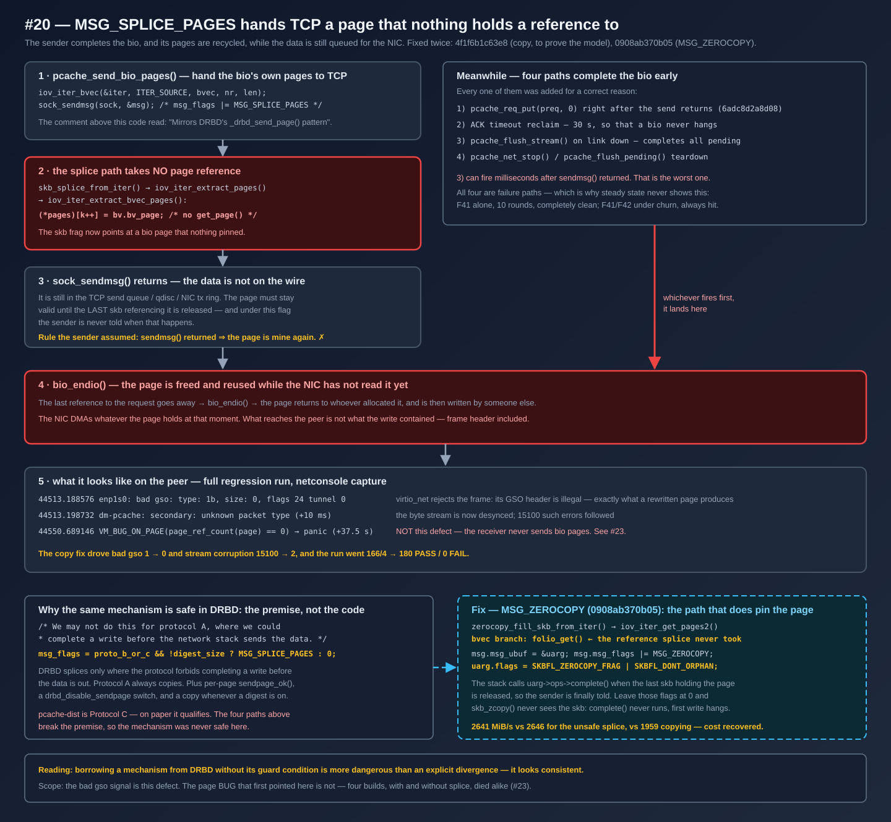
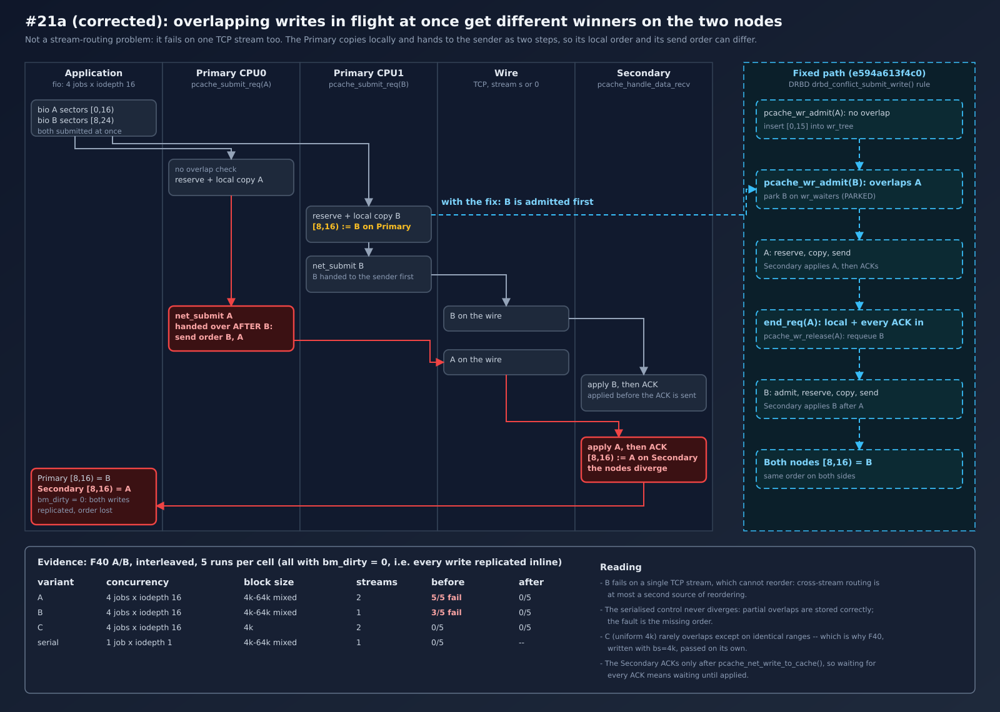
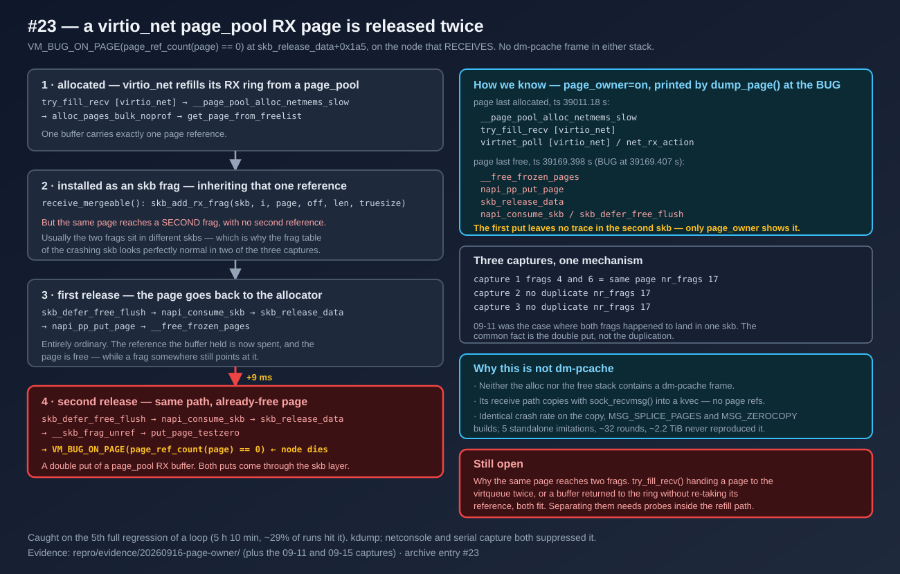
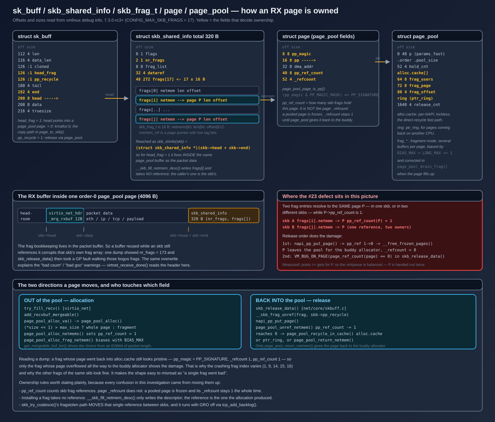
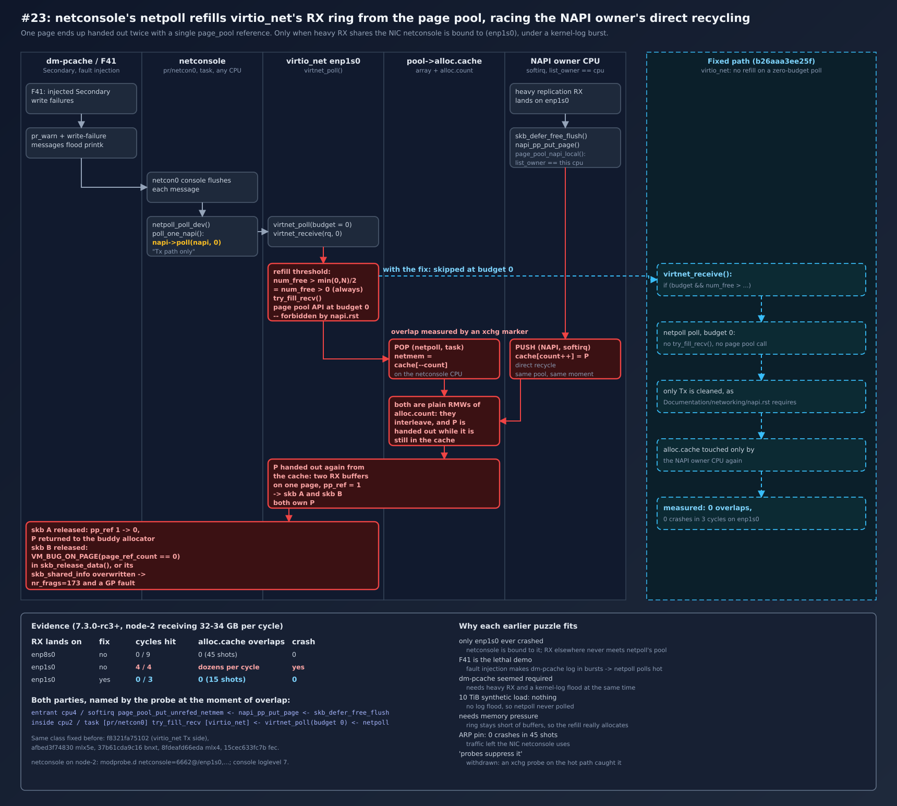

# pcache-dist 缺陷修复记录

本文记录 pcache-dist 复制功能开发期间已诊断并修正的缺陷：症状、根因、修正、验证与对应 commit。
[`pcache-dist-manual.md`](./pcache-dist-manual.md) 描述当前行为；本文说明行为为何如此、缺陷的形态，
以及修正如何得到验证。

每条的格式：**症状 → 根因 → 修正 → 验证**。验证数据来自 3 节点测试环境。
功能测试见 [`dm-pcache-test-guide.md`](./dm-pcache-test-guide.md)。BIO 后端整合中的问题见
[`bio-backend-integration.md`](./bio-backend-integration.md)。

## 目录

| # | 缺陷 | 状态 | commit |
|---|---|---|---|
| [1](#1-peers-无锁遍历导致的-uaf) | `peers[]` 无锁遍历导致的 UAF | 已修 | `2905010c7bc8` |
| [2](#2-peers_lock-在写热路径上的串行化) | `peers_lock` 在写热路径上的串行化 | 已修 | `2905010c7bc8` |
| [3](#3-三个已死的同步原语) | 三个已死的同步原语 | 已修 | `2905010c7bc8` |
| [4](#4-peer-掉线把本可成功的写变成-eio) | peer 掉线把本可成功的写变成 EIO | 已修 | `2905010c7bc8` |
| [5](#5-协商窗口入队的-pending_req-永不完成--bio-悬挂) | 协商窗口入队的 `pending_req` 永不完成 → bio 悬挂 | 已修 | `6b9406f862a4` |
| [6](#6-flush-完成码不一致运维动作变成文件系统-io-错误) | flush 完成码不一致 | 已修 | `6b9406f862a4` |
| [7](#7-pcache_free_peer-排空时漏掉引用) | `pcache_free_peer` 排空时漏掉引用 | 已修 | `ec21e3a1fd18` |
| [8](#8-resync-读-backing但它先做的-flush-不回写-backing) | resync 读 backing，但先做的 flush 不回写 backing | 已修 | `fa85857be374` |
| [9](#9-remove-peer--add-peer-造出假脑裂halt-还扣住连接) | remove-peer/add-peer 造出假脑裂，HALT 扣住连接 | 已修 | `b69033fc9b66` |
| [10](#10-多流稳态下有写被静默推迟到脏位图) | 多流稳态下有写被静默推迟到脏位图 | 已修 | `281a75149622` |
| [11](#11-fan-out-分配改回阻塞否则内存压力下静默丢复制) | fan-out 分配改回阻塞（节流而非拒绝）| 已修 | `8e066e7cbdaa` |
| [12](#12-resync-落盘失败却回-ack) | resync 落盘失败却回 ACK | 已修 | `d50fcd955a5e` |
| [13](#13-nack-把用户的写打成-eio) | NACK 把用户的写打成 EIO | 已修 | `0d6e720d70e9` |
| [14](#14-resync-读-backing-看不见还在-open-kset-里的写) | resync 读 backing 看不见还在 open kset 里的写 | 已修 | `b4f4d9672490` |
| [15](#15-被打断的-resync-被误判成脑裂) | 被打断的 resync 被误判成脑裂 | 已修 | `b3db50472e0a` + `eb15c0a9bc22` |
| [16](#16-半开连接把-peer-楔死且它自认已同步) | 半开连接把 peer 楔死，且它自认已同步 | 已修 | `1f59b35fdafb` |
| [17](#17-kthread_run-返回的指针没有引用teardown-踩到已释放的-task_struct) | `kthread_run` 返回的指针没有引用，teardown 踩到已释放的 `task_struct` | 已修 | `faa50dbc04c4` |
| [18](#18-secondary-worker-遇到可恢复错误就永久退役) | Secondary worker 遇到可恢复错误就永久退役 | 已修 | `faa50dbc04c4` |
| [19](#19-未完成的-resync-直接转-established脏位图在稳态下没有排空途径) | 未完成的 resync 直接转 ESTABLISHED，脏位图在稳态下没有排空途径 | 已修 | `0479e350ba8e` |
| [20](#20-msg_splice_pages--iter_bvec-下页引用不归网络栈持有) | `MSG_SPLICE_PAGES` + `ITER_BVEC` 下页引用不归网络栈持有 | 已修，**页 BUG 另有来源** | `4f1f6b1c63e8` + `0908ab370b05` |
| [22](#22-干净重连后仍收到-p_bitmap阶段竞态) | 干净重连后仍收到 `P_BITMAP`（阶段竞态），且意外包会让字节流错位 | 已修 | `02b954c26887` |
| [23](#23-virtio_net-page_pool-接收页被重复发放非-dm-pcache-缺陷) | virtio_net page_pool 接收页被重复发放 | 非 dm-pcache 缺陷，已修 | `9f809dce39aa`（virtio_net） |
| [21](#21-19-的两条连带回归复制被打开在系统其余部分没预期的状态里) | #19 的两条连带回归：复制被打开在系统其余部分没预期的状态里 | 已修 | `97ea254e73ee` + `15086eac489f` |
| [A](#附录-a--撤回与-resync-并发的写入仍会分歧) | 撤回：「与 resync 并发的写入仍会分歧」 | 撤回 | — |
| [B](#附录-b--测试方法要点) | 测试方法要点 | — | — |

---

## 1. `peers[]` 无锁遍历导致的 UAF

**症状**：`remove-peer` 与 I/O 并发时可解引用已释放的 `pcache_peer`。

**根因**：不加锁遍历 `peers[]` 的其实有**五处**，不止 `pcache_peer_connected()` ——
还有 `pcache_net_force_resync()`、`pcache_list_peers()`、`dm_pcache_status()`、
`bitmap-status` message。其中 `force_resync` 最危险，它是**写**（改 `bm->flags`、
对悬垂 conn 做 `sock_release`）。而 `pcache_remove_peer` 是先
`pcache_free_peer(peer)`、后把槽位置 NULL，"已释放但仍挂在 `peers[]` 上"的窗口
横跨整个 `pcache_free_peer`。同在写路径的 `pcache_has_quorum` 却是取锁的 ——
两者不一致。源码注释写着 "Step 4 introduces an RCU-protected variant"，
但模块里当时没有任何 RCU。

**修法**：`peers_lock` 由 mutex 改 **percpu_rwsem**；上述读者取读侧，装/卸槽位取
写侧；两处释放点改成**先摘链再释放**。选 percpu_rwsem 而非 RCU，是因为 fan-out
在临界区内要 `mempool_alloc`，RCU 读侧不能睡。

**证据**：VM 内核无 KASAN/LOCKDEP（仅 `CONFIG_DEBUG_LIST=y`），因此**只能靠锁覆盖
论证，无法用工具证伪**。要坐实需重编带 KASAN 的 VM 内核。

## 2. `peers_lock` 在写热路径上的串行化

**症状**：每笔复制写取两次 device 级 mutex（quorum 一次、fan-out 一次）。

**根因**：默认 `quorum=off` → `quorum_min == 1`，而 connected 从"自己"算起，
所以 `pcache_has_quorum` 的结果**恒为 true**，那次取锁纯属浪费。

**修法**：quorum 加提前返回；fan-out 改取可并发的读侧（见 [#1](#1-peers-无锁遍历导致的-uaf)）。

> **后续修正**：本条当初还把 fan-out 的 `mempool_alloc` 从 `GFP_NOIO` 改成
> `GFP_NOWAIT`（理由是别在 `peers_lock` 上睡眠堵住写侧），失败即跳过该 peer 并标脏。
> 那是**错的**：它把"复制失败"静默降级成"欠债"，而链路健康时没有东西偿还。
> 已改回阻塞分配，见 [#11](#11-fan-out-分配改回阻塞否则内存压力下静默丢复制)。

**验证 —— 吞吐中性**。同一会话交错 A/B（4 轮）：

| workload | base | new | delta |
|---|---|---|---|
| 128K seq, qd=32, streams=2 | 2509 MiB/s | 2504 MiB/s | −0.2% |
| 4K randwrite, qd=32, numjobs=4 | 161k IOPS | 160k IOPS | −0.8% |

两者都在轮内噪声 ±1.5% 内。`peers_lock` 结构上确实是 device 级串行点
（160k IOPS 下每秒约 32 万次 mutex 获取），但在测试环境中不是限制项，跨 VM 往返率才是。
因此这一项的价值在于正确性（关闭 UAF 窗口）以及为更多 peer、更快的传输留出余量，而不在吞吐。

## 3. 三个已死的同步原语

`net->connection_mutex`（只 `mutex_init`，无加锁点）、`peer->wait_for_listen`
（只 `init_waitqueue_head`）、`peer->listen_sock`（从未赋值，`pcache_free_peer`
里那个释放分支恒不执行）—— 都是监听 socket 收归 network 级之后的残留，已删除。

`peer->listen_sock` 尤其误导：它暗示每 peer 有独立监听，与手册 §3.6 描述的
"network 级单一 `listen_sock` + 单一 `accept_thread`"直接矛盾。

## 4. peer 掉线把本可成功的写变成 EIO

**症状**：链路断开的瞬间，正在进行的写返回 EIO 给文件系统。

**根因**：`pcache_submit_req` 在 `pcache_net_submit_write` 返回 `-ENOTCONN` 时
（探测到有 peer、fan-out 前最后一个 peer 掉线）把该错误传给 `pcache_req_put`。
但此时数据**已本地 commit、所有 peer 已标脏**，与"一开始就没有 peer"的慢路径
状态完全相同 —— 而那条路径算成功。同函数的 flush 分支本来就传 0，两边不一致
即是佐证。

**修法**：只在**真配了 quorum 且已失去 quorum** 时才失败，否则降级为"单机 + 标脏"。

**影响时机很糟**：链路断开、正准备 failover 的那一刻，正是把写打回 EIO 的时刻。

## 5. 协商窗口入队的 `pending_req` 永不完成 → bio 悬挂

**症状**：上层（fio）挂死在 `read_events` 上不退。

**根因**：`pcache_create_peer_socket` 在 `kernel_connect` 成功后**立刻**置
`peer->state = PCACHE_C_CONNECTED`，早于 handshake / sync_params / resync。但
`streams[0]->pending_list` **只在 `pcache_primary_worker` 的 ESTABLISHED 循环里
才被排空**，所以协商期入队的 req 没有任何线程会送它。若协商随后失败，失败分支
只做 `state = CONNECTING; continue`，**不 flush**：

```c
/* 失败分支不 flush pending_list —— req 就此永远悬着 */
peer->state = PCACHE_C_CONNECTING;
pcache_set_repl_state(peer, PCACHE_R_OFF);
schedule_timeout(HZ);
continue;
```

30 秒 ACK 超时回收器位于 ESTABLISHED 循环内，这条路径到不了。

**这个窗口不是罕见情况**：节点重启时按手册 §8.1 的标准顺序（`dmsetup create`
先起 listen socket、`add-peer` 稍后）就会命中 —— accept 打
`no peer slot for node_id; drop`，对端 sync_params 收 ECONNRESET。实测 12 秒
间隙内**命中 11 次**。

**两档后果**：

| 场景 | 后果 |
|---|---|
| 暂时性（重启、create→add-peer 间隙）| 写**停顿**到重连成功，之后完成 |
| 协商**永远**不成功（split-brain HALT、两侧 peer 名录不对称）| 写永久悬挂 |

**修法**：两半。(a) 复制资格与连接状态分离 —— `pcache_peer_can_replicate()` 要求
`state == CONNECTED && repl_state == ESTABLISHED`，未 ESTABLISHED 走标脏路径由
resync 交付；(b) `pcache_primary_worker` 回 `connect:` 时补
`pcache_flush_stream(cst, 0)`，兜住抢在状态切换前入队的 req。

`pcache_has_quorum` **刻意没跟着改**（仍按连接层计数）：改了会让每次重连都触发
写围栏，那是另一个语义决定。

**证据**：

| 场景 | 修前 | 修后 |
|---|---|---|
| 写 I/O 并发反复 remove-peer/add-peer | fio 挂死（187 次重连失败）| 完成，`io_errors=0` |
| 节点重启：create 早于 add-peer 12s | 写停顿 12s（命中窗口 11 次）| 完成，`errors=0` |
| 稳态复制写 | 2333 MiB/s | 2333 MiB/s |

A/B（3 轮交错，128K seq qd=32 streams=2）：2521 → 2522 MiB/s，**无代价**。

**先确认是既有问题再修**：同一 churn 脚本在改动前后的 `.ko` 上症状完全一致
（均 187 次重连失败 + fio 挂死），确认不是当时的锁改动引入的。

## 6. flush 完成码不一致（运维动作变成文件系统 I/O 错误）

**症状**：churn 修好挂死后，fio 报 `io_errors=4`。

**根因**：`pcache_flush_stream` 在完成 bio 前会先 `pcache_bm_set_range` 标脏，
所以"已本地 commit + 已标脏"的正确完成码是 **0**。但原先只有 link-death 一处
用 0，其余三处用 `-EIO`。先触发的是 **worker `exit:` 路径**（`kthread_stop` 时跑，早于
remove_peer 自己那次 flush）加上 `pcache_data_stream_stop`。

**修法**：统一为 0，只有 dtr 销毁设备保留 `-EIO`。

| 位置 | 场景 | 完成码 |
|---|---|---|
| `pcache_primary_receiver` link death | 链路死亡 | 0（原本就对）|
| `pcache_primary_worker` `connect:` | 协商失败重连 | 0（新增）|
| `pcache_primary_worker` `exit:` | remove-peer / set-role / 拆设备 | 0（原 `-EIO`）|
| `pcache_data_stream_stop` | 数据流拆除 | 0（原 `-EIO`）|
| `pcache_remove_peer` | 移除 peer | 0（原 `-EIO`）|
| `pcache_net_stop` | dtr 设备销毁 | `-EIO`（保留）|

**证据**：三处改 0 后 `io_errors=0`。

## 7. `pcache_free_peer` 排空时漏掉引用

**症状**：不可达路径，但若触发则 dtr 卡死在 `inflight_wq`。

**根因**：兜底排空把 `pending_req` 直接 `mempool_free`，**不做 `pcache_req_put`** ——
每个 req 持着 `pcache_request` 一份引用，漏掉就是 bio 永不 `bio_endio`、
`inflight_reqs` 永不递减。另外它只遍历 `streams[0]`，`nr_streams > 1` 时数据流的
pending 链表整个漏掉。

**修法**：遍历所有 stream；先 `pcache_bm_set_range` 标脏再 `pcache_req_put(req, 0)`；
排空提前到 `pcache_peer_bitmap_exit` 之前（这样 `peer->bm` 还活着能标脏）；
真排出东西时打日志而不是静默。

**证据 —— 验证它确实不可达**（这才是重点，因为正常路径跑不到那段代码）：
churn 下 `remove-peer` 调用 `pcache_free_peer` 四次，新计数器报告排空 **0 个**
→ 所有调用点确实都先 `pcache_flush_pending` 清干净了，新增代码没有造成双重 put。
`CONFIG_DEBUG_LIST=y` 下两节点 dmesg 的 `BUG:/WARNING:/list_*corruption` 命中 **0**；
`dmsetup remove` → `rmmod` 两节点都成功（模块引用计数配平）。

## 8. resync 读 backing，但它先做的 flush 不回写 backing

**症状**：resync 报 `resync done (dirty=0)`、两端 ESTABLISHED + `bm_dirty=0`，
**却持有不同数据**。绕过 §7.2 的全部检测：无 HALT、无告警、无脏位。

**根因**：`pcache_do_resync` 直接读 **backing** 发送，开头那句的注释是骗人的 ——

```c
/* Flush PMEM cache → backing so we can read the latest data from the
 * backing device during resync. */
ret = pcache_cache_flush(&pcache->cache);   /* 只 close kset：元数据→PMEM */
```

`pcache_cache_flush`（`cache_req.c`）只是逐个 `cache_kset_close`，即把**元数据
持久化到 PMEM**，**不触发脏数据回写 backing**。

**修法**：新增 `pcache_cache_writeback_all()`（`cache_writeback.c`）—— 踢 writeback
worker 并等 `dirty_tail` 追上 `key_head`。`is_cache_clean()` 解析进
`cache->wb_kset_onmedia_buf`（worker 也用这块缓冲），所以探测在 `writeback_lock`
下进行，锁序与 `cache_writeback_fn` 一致，睡眠前先放锁让 worker 能推进。

同一循环里另外两个洞一并修了：

| 洞 | 修法 |
|---|---|
| 预循环 drain 只覆盖第一个 chunk（resync 期间的写持续弄脏 cache）| 每 chunk 前复查；已干净时只花一次 PMEM kset 读 |
| `pcache_bm_clear_range` 在 ACK **之后**，会清掉"读 backing 之后才写入"所设的脏位 —— 那份数据既没发出、也不再被记为欠账 | 改为**读之前先清**，并发写会重新弄脏、后续趟次捞回；clear 与 ACK 之间每条错误路径都恢复该范围 |
| cursor 只单调前进，被并发写重新弄脏、位于其后方的区域永不重扫，而 `pcache_bm_mark_synced` 照样宣告已同步 | 多趟扫描，某趟无进展即停（写手快过 resync 时不空转），且**只有真正清空才 `mark_synced`** |

**验证**（同场景两个构建对跑：脏 cache 起 resync、无并发写）：

| 构建 | node-1 与 node-2 |
|---|---|
| 修复前 | 不一致（却报 `resync done (dirty=0)`）|
| 修复后 | 一致 |

**代价**：慢链路 + 持续写下 resync 明显变长 —— 10ms 延迟、512 MiB 设备、写手不停
时约 **215 秒**才 `dirty=0`（静止不限速约 0.3 秒）。每趟约 2048 chunk × RTT。
若这成为问题，方向是改成**透过 cache 读**，而不是缩短超时或砍趟数。

## 9. remove-peer / add-peer 造出假脑裂，HALT 还扣住连接

**症状**：`remove-peer` 后 `add-peer`，两节点陷入永久楔死 —— 对端每秒打
`sync_params exchange failed: -104`，本端每秒打 `already connected; drop dup`，
`force-resync` 也打不破。

**根因（两层）**：

1. **假脑裂**：`remove-peer` 打 TOMBSTONE 后重加入走 `pcache_registry_add` 复用
   **同一槽位**，而 `pcache_peer_bitmap_init` 只看 PMEM 头的 magic/几何就当既有
   peer 载回，**复活了已不存在关系的 gen 簿记** → `decide_sync_role` 互证条件
   断裂 → 判 split-brain 并 HALT。实测触发链：
   `sync_params: my(gen=2,peer_at=2,full=0) peer(gen=3,peer_at=1,full=0)`
   → `incompatible generations, halting replication`。
2. **HALT 扣住连接**：`pcache_secondary_worker` 里的 `conn_put`/`conn_drop` 原先
   写在"等到 `kthread_should_stop`"的循环**之后**，只有拆卸时才执行 —— 正常 HALT
   期间 stream 上始终挂着 conn，accept 线程遂把对端每次重连判为 dup。对端只看到
   ECONNRESET，**拿不到 split-brain 诊断**。

**修法**：

1. `pcache_peer_bitmap_init` 新增 `force_fresh`；`pcache_add_peer` 在走
   `registry_add()` 拿槽位时（首次加入，或 remove 之后的重加入）传 `true`，跳过
   PMEM 头载入。位图遂以 `FULL_SYNC_NEEDED` 起步，`decide_sync_role` 的**全量分支
   先命中，结构上到不了 HALT 判定**。
2. 释放移到进入等待**之前**（两个 worker 都改），并让 accept 线程对 `split_brain`
   的 peer 直接拒绝且日志点名恢复命令。

**证据 —— 确定性对照**（先前靠 churn 撞的 A/B 不可靠，因为假脑裂是时序相关的）：

| 构建 | 重加入后的位图 | sync_params |
|---|---|---|
| 修复前 | `loaded gen=1 peer_gen=1` | `my(gen=1,peer_at=1,full=0)` → 可落到 HALT |
| 修复后 | `fresh` | `my(gen=1,peer_at=0,full=1)` → 走全量分支 |

**区分保住了**：重挂**仍存活**的 registry 条目（设备重建、registry 从 PMEM 恢复）
照旧载入持久化位图 —— 那才是持久化 registry 的意义；瞬时断连也不受影响
（peer 仍在册，实测 F11 依旧只同步 256 位而非全量 131072 位）。

顺带消除了 `dm-pcache-test-guide.md` 附录 A Finding 1 记的运维陷阱：重加入的 peer
不再需要人工 `force-resync` 才不至于静默陈旧。

**回归**：F24（分歧保留、复制停摆）、F25（人工裁决收敛）均通过。

## 10. 多流稳态下有写被静默推迟到脏位图

> **复现流程图（UML 活动图）**：[`assets/repro-10-multistream-silent-debt.svg`](./assets/repro-10-multistream-silent-debt.svg)

**症状**：`streams=2` 时，在**已 settle**（工作负载开始前 `bm_dirty=0`）的连接上跑
重叠并发写，结束后出现非零 `bm_dirty`、两端 md5 不同；`streams=1` 同样负载则一致；
事后 `force-resync` 可收敛。Primary 的 dmesg **完全是空的** —— 这是最初难查的原因。

**定位过程**：Primary 侧枚举所有标脏路径（`pcache_flush_stream`、
`!can_replicate` 分支、mempool 失败、NACK）都没有日志。改从 **Secondary** 抓
dmesg，才看到刷屏的：

```
pcache_handle_data_recv:486 write to cache failed: -16 (sector=13072 size=4096)
```

`-16` = `-EBUSY`。Secondary 落盘失败 → 回 NACK → Primary 在 `pcache_handle_ack`
里把该区标脏。Primary 无日志，是因为 NACK 处理本来就不打日志。

**根因**：Secondary 的背压不完整。

```
pcache_net_write_to_cache
  → pcache_wait_seg(cache, key)        /* 在 cache_data_alloc 的 -EBUSY 上等待 ✅ */
  → memcpy_flushcache / cache_key_insert
  → cache_key_append(cache, key, fua)
      → kset 满(128 keys) 或 fua → cache_kset_close()
          → get_cache_segment() 拿不到段 → -EBUSY   ← 没有任何等待，直接失败 ❌
```

手册 §2.5 描述的"Secondary 侧不返回 `-EBUSY`，而是在 `seg_wait_wq` 上等段释放"
**只覆盖了数据分配那一步**，没覆盖 kset 关闭。4K 重叠写让 key 累积极快、kset 频繁
关闭；`streams=2` 时 Secondary 有两个接收线程并发提交，段压力更大，所以只在多流
下显现。

**修法**：`cache_key_append` 返回 `-EBUSY` 时走同样的背压 —— 等段释放后**重做该
chunk**（`io_done` 不推进，错误路径本就已释放 key 与其预留），而不是让写失败。
非 `-EBUSY` 的错误照旧返回。

**证据**（同一重叠写负载，`streams=2`）：

| 构建 | Secondary `write to cache failed: -16` | `bm_dirty` | md5 |
|---|---|---|---|
| 修复前 | **37 次** | 36 | 分歧 |
| 修复后 | **0 次** | 0 | 一致 |

F40 由此转绿，且它的保序断言这才真正在验 §3.3 的保序（此前是被欠债掩盖的）。

**残留的设计缺口（未修）**：**ESTABLISHED 期间累积的脏位仍然没有偿还机制** ——
只有重连或人工 `force-resync` 才触发 resync。修掉本条之后，健康运行中已不再有
脏位来源，所以严重性大幅下降；但任何真实的瞬时故障仍会留下静默欠债。
`dmsetup status` 的 `bm_dirty` 是唯一可观测指标，监控应纳入告警。

## 11. fan-out 分配改回阻塞，否则内存压力下静默丢复制

> **复现流程图（UML 活动图）**：[`assets/repro-11-fanout-nowait-silent-loss.svg`](./assets/repro-11-fanout-nowait-silent-loss.svg)

**背景**：[#2](#2-peers_lock-在写热路径上的串行化) 把 fan-out 的
`mempool_alloc(net->req_pool, GFP_NOIO)` 改成了 `GFP_NOWAIT`，失败即跳过该 peer
并 `pcache_bm_set_range` 标脏。

**问题**：这条路径在**链路完全健康**时触发（池 1024 元素耗尽），而
[#10](#10-多流稳态下有写被静默推迟到脏位图) 的残留缺口说明：ESTABLISHED 期间标的
脏位只在下次握手才被排空。一个健康跑几天的集群，这几天里 Secondary 就是静默陈旧的。
用"绝不静默丢复制"换"内存压力下管理命令可能变慢"，方向反了。

**DRBD 怎么做的**（这是决定改回去的依据）：

- 资源不足时**节流而非拒绝**。`drbd_alloc_pages()` 的注释写明：超过 `max-buffers`
  就用 `schedule_timeout` 节流，并解释了为什么不用硬上限 ——
  *"could lead to congestion and, further, to a distributed deadlock"*。
- 只有**真实 I/O 错误**才 `P_NEG_ACK`：
  ```c
  /* drbd_receiver.c */
  if (unlikely(peer_req->flags & EE_WAS_ERROR)) {
          pcmd = P_NEG_ACK;
  ```

**修法**：改回 `GFP_NOIO`。当初的顾虑（在锁上睡眠）已不成立 —— `peers_lock` 现在是
percpu_rwsem，这里走的是**读侧**，睡眠只会延迟一个待处理的写者（add/remove-peer），
不会死锁。

**代价已实测（F45）**：两节点各占 60% 可用内存、无 swap 的条件下，管理命令
**0 秒**完成、写手正常退出、**用户 I/O 错误 0**、压力解除后数据一致。担心的代价
没有出现 —— mempool 有 1024 个预留元素，而单 peer / iodepth 32 的在飞量只有几十，
阻塞路径实际走不到。

**另可参考 —— #10 残留缺口的根本形状**：DRBD 的 `P_NEG_ACK` 除了标脏，还会把 peer
的 disk state 压到 `UpToDate` 以下（`GOT_NEG_ACK` 标志，`drbd_int.h` 注释：
*"wait until peer_disk is lower than D_UP_TO_DATE before becoming secondary"*），
于是**状态机**知道欠了一次 resync。pcache-dist 标了脏位却把 `repl_state` 留在
ESTABLISHED，所以没有任何东西知道。**尚未处理。**

## 12. resync 落盘失败却回 ACK

> **复现流程图（UML 活动图）**：[`assets/repro-12-resync-write-failure-acked.svg`](./assets/repro-12-resync-write-failure-acked.svg)

**症状**：无（这正是问题所在）。发生时两端都认为同步完成。

**根因**：`pcache_handle_rs_data_recv` 里，落盘失败只打日志，**ACK 仍然无条件发出**：

```c
ret = pcache_net_write_to_cache(&pcache->cache, sector, data, size, false);
if (ret)
        pcache_err("secondary: RS_DATA write_to_cache failed: %d\n", ret);
...
ack.type = cpu_to_le16(PCACHE_P_RS_ACK);   /* 无条件 */
```

而 [#8](#8-resync-读-backing但它先做的-flush-不回写-backing) 把脏位改成了**读之前
就清**。两者叠加的后果是：源端先清掉该段脏位 → 读 backing → 发出 → 收到"成功"的
ACK → 认为已交付。**数据既没送到、也不再被记为欠账**，最后 `resync done (dirty=0)`。
两端 `bm_dirty` 皆为 0，没有任何指标显示异常。

**修法**：落盘失败**不回 ACK**，直接返回错误让连接断开。源端的错误路径会
`pcache_bm_set_range` 恢复该段（见 [#8](#8-resync-读-backing但它先做的-flush-不回写-backing)
的错误处理），重连后 resync 继续。

**DRBD 怎么做的**：它有专门的 `P_RS_NEG_ACK` 来显式表示"这块 resync 数据我没写下"。
断连接能拿到同样的安全性且**不必升协议版本**，代价是重做已在途的若干 chunk。
若将来 RS 路径需要更细的粒度，`P_RS_NEG_ACK` 是正确的方向。

**限制**：这是一个**确定的**缺陷（把失败报告成成功，任何情况下都是错的），已独立
修复。但它是否就是 [#14](#14-resync-读-backing-看不见还在-open-kset-里的写) 的全部原因**未经证实** ——
从未在一次失败现场抓到 `RS_DATA write_to_cache failed` 的日志。

## 13. NACK 把用户的写打成 EIO

> **复现流程图（UML 活动图）**：[`assets/repro-13-nack-becomes-eio.svg`](./assets/repro-13-nack-becomes-eio.svg)

**症状**：F37（写负载下 Secondary 重启）偶发报 `fio total_err=5`。

**根因**：`pcache_handle_ack` 收到 NACK 时直接用 `-EIO` 完成 bio：

```c
pcache_req_put(found->pcache_req, success ? 0 : -EIO);
```

实测触发链：`dmsetup remove` 期间 Secondary 的 `pcache_is_stopping()` 为真，
`pcache_wait_seg` 返回 `-EIO` → `pcache_handle_data_recv` 打
`write to cache failed: -5` 并回 NACK（**正好 5 条，对应 `total_err=5`**）→
Primary 把这 5 笔写打回文件系统。

**这与 [#4](#4-peer-掉线把本可成功的写变成-eio) 是同一类缺陷** —— #4 修好了
`-ENOTCONN` 那条路径，却漏了 NACK 这条。NACK 时该区**已被标脏**（就在上面几行）、
数据**已本地 commit**，与"一开始就没有 peer"的状态完全相同，而那条路径算成功。

**修法**：只在**真配了 quorum 且已失去**时才 `-EIO`，否则完成为 0。

**DRBD 怎么做的**：`P_NEG_ACK` 会让 peer 的 disk state 降到 `UpToDate` 以下并标
out-of-sync，但**应用的写照常完成** —— 本地盘有数据，不该因为一个副本拒收就把
应用的 I/O 打回去。

## 14. resync 读 backing 看不见还在 open kset 里的写

> **复现流程图（UML 活动图）**：[`assets/repro-14-open-kset-stale-read.svg`](./assets/repro-14-open-kset-stale-read.svg)

**状态：已修 `b4f4d9672490`。** 给写手限速后才能按需复现。

**症状**：`demo_features.sh f39` 偶发失败，失败时**每一项指标都正常**：

| 指标 | 值 |
|---|---|
| 两端 `bm_dirty` | `0` |
| Primary 的 resync 裁决 | `resync done (dirty=0)` |
| `repl_state` | 两端 ESTABLISHED |
| Secondary 写失败日志 | 0 |
| 64 MiB md5 | **不同，且不自愈** |

**根因**：`pcache_do_resync` 逐 chunk 直接读 **backing**，读前用
`pcache_cache_writeback_all()` 排空缓存。而它的 clean 判据 `is_cache_clean(dirty_tail)`
是读 dirty_tail 处的 kset —— **看不见还留在未关闭 kset 里的 key**。
`cache_key_append()` 只在 kset 写满时立即关闭，否则交给延迟工作（最长 1 秒），
所以在持续写下这个盲区几乎一直开着。

sweep 是**先清位再读**的（这样读之后才到的写会重新标脏）。该设计成立的前提是
"位是脏的 ⟹ 数据对读 chunk 的人可见"。破的正是这一半：

```
T0  写 W commit（数据进 PMEM，key 进 open kset）
T1  mark_all_peers_dirty 置脏位
T2  sweep 扫到该 chunk，clear_range 清掉 W 的位
T3  writeback_all -> is_cache_clean 看不见 open kset -> 立即返回 0
T4  读 backing = 旧数据，发 RS_DATA，收 ACK，位保持清
之后 kset 关闭、W 被写回 Primary 的 backing
=> Primary device/backing 皆新，Secondary 皆旧，bm_dirty=0，无任何错误
```

机制图：[`assets/resync-stale-backing-read.svg`](./assets/resync-stale-backing-read.svg)

**为什么只有 8-17%**：绝大多数被发陈旧的区段会被后续写重新标脏、下一趟补发，
或在转 ESTABLISHED 之后被内联写覆盖修复。只有**最后一趟里被发陈旧、且此后再没被
写过**的区段留下永久分歧 —— 需要 resync 收尾与写手停止的时间凑到一起。

**为什么不限速的 F39 测不到**：写手不限速时约 530 MiB/s、8474 IOPS，
逐 chunk 的 drain 要求**整个缓存**干净，永远等不到 —— 预循环超时 30 秒、chunk 0
再超时 30 秒，sweep **一个 chunk 都没发**就结束（`incomplete, 131072 bit(s) still
owed`）。F39 最后 md5 一致靠的是 resync 放弃后的内联复制。
测试没有执行到出问题的代码。

**按需复现配方**（[`tests/repro/f39_silent_loss.sh`](../tests/repro/f39_silent_loss.sh)）：

1. 写手**限速 400 IOPS**（≈25 MiB/s），让 drain 追得上、sweep 真的开始流；
2. 在 resync 报出裁决的**瞬间**杀掉写手（`pkill -x fio`，见下），断掉事后修复窗口；
3. 用一次静置 resync 把**已记录**的欠债还清；
4. 再比对：还不同的，就是既没送到、也没记录的。

**A/B**（同一配方）：

| 构建 | 结果 |
|---|---|
| 修前 `b3db5047` | **2/2 分歧**：8 个 64 MiB 分块全部不同、两端 `bm_dirty=0`、日志 `resync done (dirty=0)`、无错误 |
| 修后 `b4f4d9672490` | **3/3 收敛**：还清已记录欠债后两端 md5 完全一致 |

**修法**：把 `pcache_cache_flush()` 折进 `pcache_cache_writeback_all()` 开头，
而不是只补那一个调用点 —— 它的全部调用者都是"接下来要直接读 backing"，
折进去之后**没人再有办法要到半个 drain**。`cache_kset_close()` 对空 kset 直接返回，
所以没东西可关时这次 flush 不花钱。

**代价**：drain 现在真的会等，同样负载下一趟 sweep 携带量下降 ——
45 秒/69k 位 → 130-185 秒/26k 位，剩下的如实记为欠债留给下一趟。
这也说明"每个 chunk 排空整个缓存再读 backing"这个形状本身值得换掉，见下。

**更根本的方向（未做）**：resync 需要的只是某区段的**当前内容**，而它可以直接
**穿过缓存读**（`cache_read` 的形状：命中读 PMEM、未命中读 backing）。那样 drain、
两个 30 秒超时、stall 分支和本条的窗口会一起消失。DRBD 没有这个问题，正是因为它的
resync 读和应用写落在同一个存储上 —— 它需要的互斥是另一回事（见下）。

**DRBD 对照**：DRBD 把 resync 读以 `INTERVAL_RESYNC_READ` 注册进和
`INTERVAL_LOCAL_WRITE` 同一棵 interval tree，由 `drbd_find_conflict()` /
`drbd_should_defer_to_resync()`（`drbd_int.h`）保证两者互斥，注释原话是
*"The exclusivity between resync requests and application writes ... is necessary
to avoid overwriting newer data with older in the resync."*；并且它**收到 ack 才清位**
（`got_RSWriteAck` → `drbd_set_in_sync`），从不在读之前清。pcache 的 clear-before-read
是"没有互斥"的替代品，只在上面那条蕴含成立时才安全。

**已排除的可能**：

| 假设 | 排除依据 |
|---|---|
| [#11](#11-fan-out-分配改回阻塞否则内存压力下静默丢复制) 引入 | 15-3 vs 6-0，p≈1.0；且 resync 期间 fan-out 根本不被调用 |
| `mark_synced` 清掉了脏位 | 它只改 `peer_gen_at_sync`/flags/`gen_dirty`，不碰位图 |
| clear-before-read 范围错位 | `find_next_dirty` 会更新 `*start_bit`，clear/read/send 用同一组 sector/size |
| RS_DATA 与 P_DATA 乱序 | streams=1 全走 stream 0；`can_replicate` 要求 ESTABLISHED，P_DATA 只能在 resync 后入队 |
| resync 漏扫某些区段 | `force-resync` 置全脏位，且循环报 `dirty=0` |
| 位取整方向不一致导致清过头 | `set_range`/`clear_range` 共用 `pcache_bm_range_to_bits`；两个 `clear_range` 调用点的 sector/size 都位对齐（Primary 由 `cursor`/`nr_bits` 算出，Secondary 从线上收），当前不触发 —— 但见下方隐患 |
| [#12](#12-resync-落盘失败却回-ack) 是根因 | 修复后失败率无显著变化，且从未在失败现场抓到该日志 |
| 上面这条（open kset 对 drain 不可见）| **就是根因**，A/B 见上 |

**⚠️ 同族的第二个洞（多 peer 才触发，未修）**：当另有 peer 处于 ESTABLISHED 时走
快路径，`pcache_net_submit_write()` 对不能复制的 peer 调 `pcache_bm_set_range()`，
而这在 `pcache_cache_write_commit()` **之前** —— "位脏"早于"数据存在"，补 flush 也
堵不住。2 节点的 F39 不走这条（`pcache_peer_connected()` 要求 `can_replicate`，
resync 期间为假，走的是"先 commit 再标脏"的慢路径）。

## 15. 被打断的 resync 被误判成脑裂

**症状**：写负载下触发 resync，两端双双 HALT 报 split-brain、需要人工裁决，
而实际上**没有任何分歧** —— Secondary 一个字节的积压都没收到。

**证据链**（F43）：

```
writeback drain before resync failed: -110         ← -ETIMEDOUT
resync failed: -110, reconnecting                   ← 整个 resync 中止并撕连接
sync_params: my(gen=2,peer_at=1) peer(gen=2,peer_at=1)
incompatible generations, halting replication       ← 两端都判脑裂
```

Secondary 的 12 个 8 MiB 分块 md5 **完全相同**（全零），两端 `bm_dirty=131072/131072`。

**根因（两层）**：

1. **误判**：resync 中途中止后，源端已 bump generation 并开始发送，但 `mark_synced`
   没跑，目标端的 `peer_gen_at_sync` 仍停在旧值。两端遂报出**相同的 gen + 落后的
   peer_gen_at_sync** —— 正是 `decide_sync_role` 用来识别"同代但互证断裂"的特征。
2. **为什么会中止**：[#8](#8-resync-读-backing但它先做的-flush-不回写-backing) 加的
   writeback drain 在写手跑赢 writeback 时返回 `-ETIMEDOUT`，这个错误一路上升，
   最终导致**撕连接**。

**修法**：

- 区分信息**本来就有**：`PCACHE_BM_F_RESYNC_IN_PROGRESS` 在 `pcache_do_resync`
  开头就设、`mark_synced` 清除 —— 只是从来只在崩溃后加载位图时被读过，
  `decide_sync_role` 不看它。新增协议 flag 位传播它，在落到脑裂分支**之前**按它
  指出的方向恢复（SOURCE / TARGET）。
- drain 超时不再撕连接：预循环超时改为继续扫描（每 chunk 会复查）；每 chunk 超时则
  **恢复该段脏位**并优雅结束本轮 sweep，让多趟逻辑如实报 `incomplete`。

**验证**（F43，同一场景）：

| | 修复前 | 修复后 |
|---|---|---|
| 结局 | 两端 HALT 假脑裂 | `resync incomplete, 131072 bit(s) still owed (writer outran resync)` |
| Secondary 数据 | 全零（积压一字节未收）| 写手停后一次静置 resync 立即收敛 |
| 欠债记录 | —— | `bm_dirty=131072`，如实保留 |

这也是 **#8 的"无进展即停"分支第一次真正执行** —— 写进代码后从未被触发过。

**后续修正（`eb15c0a9bc22`）**：上述修正不完整。F48 复现出同一族的另一条路径 ——
resync 反复被打断时，位图交换会 bump 接收方的 generation，几轮之后两端代数彻底错开，
`RESYNC_IN_PROGRESS` 的恢复分支也救不回来，最终仍判 `incompatible generations` 而 HALT：

```
resync starting (dirty=7632) → incomplete, 57760 bit(s) still owed
my(gen=2,peer_at=1) peer(gen=3,peer_at=2) → decided role = SYNC_TARGET   ← 角色反转
BITMAP_EXCHANGE → ESTABLISHED                                            ← 一个字节没传
my(gen=3,peer_at=3) peer(gen=4,peer_at=2) → incompatible generations → HALT
```

根因是把"对端还缺什么"（位图）当成了"我持有哪份数据"（generation）。
已于 `eb15c0a9bc22` 修复（三处：位图合并不 bump generation、`P_BITMAP_DONE` 带上
`left`、`decide_sync_role` 把脏位纳入判据）。F48 由 2/2 失败变为 6/6 通过。

**要点**：#8 让 drain 超时返回错误，该错误一路上升为断开连接，再被恢复路径误判为脑裂。
给深层路径加超时时，需要检查最外层如何处理这个错误。


## 16. 半开连接把 peer 楔死，且它自认已同步

**状态：已修 `1f59b35fdafb`。** 由 F49（移植自 `resync-multiple-interrupt`）发现。

> **原因流程图（UML 活动图）**：[`assets/cause-16-half-close-wedge.svg`](./assets/cause-16-half-close-wedge.svg)

**症状**：Secondary 无限循环拒绝 Primary 的重连，双方都没有出路：

```
node-2:  accept: peer node_id=0 stream=0 already connected; drop dup   (每秒)
node-1:  handshake complete (initiator)
         sync_params exchange failed: -104                             (每秒)
```

实测 **20 分钟以上不自愈**（F49 的 420 秒窗口全程如此，之后单独观察到同一个
陈旧 socket 四元组仍在、dup 计数仍在涨）。终态最糟的部分是
node-2 自己的账面：`bm_gen=1 bm_dirty=0` —— **它认为自己完全同步**，
而数据与另外两个节点不同。

**触发条件**：**非对称**链路故障。F49 用 `block_outbound_to` 只挡住 Primary
→ Secondary 一个方向（防火墙规则、单向丢包、非对称路由都会造成同样的效果）。
Primary 侧的 socket 被 `abort-resync` 关掉了，Secondary 侧那半却**从未被判死**，
于是 accept 路径把 Primary 每一次重连都当成 dup 丢弃。

**socket 层证据（楔死期间两端同时抓）**：

```
node-2:  ESTAB        <node-2>:9764  <-  <node-1>:41008     ← 它认为连接活着
node-1:  FIN-WAIT-1   <node-1>:41008 ->  <node-2>:9764      ← 它已经关了，FIN 送不过去
```

**为什么 TCP keepalive 救不了**：`pcache_setup_socket` 配了
`TCP_KEEPIDLE=20 / KEEPINTVL=10 / KEEPCNT=3`（最坏 50 秒），但这里是**半关闭**
而不是"对端消失"：node-1 那个 socket 仍处于 FIN-WAIT-1，**照常应答 keepalive 探测**，
于是 node-2 的 keepalive 永远满意，永远不判死。
**传输层的存活 ≠ 应用层的存活**，靠 keepalive 决定"对端还在不在"在半关闭下不成立。

**确定性**：最小配方（单向挡 Primary → Secondary、`abort-resync` 关掉 Primary 侧
socket、在对端 keepalive 反应过来之前的 5 秒内恢复链路）**3/3 复现**
（F49 一次，复现脚本两轮独立触发，每轮均 300 秒不自愈；两轮之间集群已恢复，属于独立观察）。

**运维出路（已直接验证）**：在楔死 20 分钟之后，于 Primary 上执行一次
`force-resync`（它丢掉 Primary 侧全部 socket）—— **10 秒内握手成功**、
`decided role = SYNC_SOURCE`、resync 正常开始。`abort-resync` 同样丢 socket，
预期效果相同（未单独验证）。

> 注意：没有写入时 `bm_dirty` 本来就是 0，它不是连接存活的指标；判断是否卡住应直接查看 socket 状态与 dup 计数。

**这与 [#9](#9-remove-peer--add-peer-造出假脑裂halt-还扣住连接) 是同一个楔子的另一个入口。**
#9 修的是 HALT 期间不释放 conn 导致 accept 判 dup；这次 conn 没被 HALT 扣住，
而是**根本没人认为它死了**。#9 的教训（"对端只看到 ECONNRESET，拿不到诊断"）原样重演。

**DRBD 怎么做的**（两点，都不在传输层）：

- **应用层 ping**：`ping_int`（默认 10 秒）+ `ping_timeo`，并据此设 socket 收超时 ——
  `set_rcvtimeo(DATA_STREAM, ping_timeo * 4 * HZ/10)`、
  `set_rcvtimeo(CONTROL_STREAM, ping_int * HZ)`（`conn_connect`，`drbd_receiver.c`）。
  每一侧都能在有界时间内**独立**判定连接已死，不依赖是哪个方向坏掉。
- **交叉/重复连接由协议处理而不是一丢了之**：`conn_connect` 有完整的
  crossed-connection 处理，不会让对端陷入"永远被拒"的状态。

**修法**：accept 路径按**连接方向**区分两种情况 ——
`pcache_peer_is_initiator()` 已经规定了谁拨向谁：

| 情况 | 处理 |
|---|---|
| **我方拨向该 peer**（initiator）：收到它的入连接 | 同时拨号的竞态，我方那条才是要留的 → 照旧丢弃（原行为）|
| **该 peer 拨向我方**（responder）：收到它的入连接 | **不可能是竞态** —— 我方从不拨向它。这就是对端在说"我已经放弃了你还拿着的那条" → 丢掉我方那条陈旧 conn |

丢掉之后**不就地安装**这个 socket，而是让对端下一次重试（约每秒一次）落进来：
就地安装会与 per-peer worker 自己的拆除路径抢 —— 它 drop 的是"当时装着的那条"，
会把刚装上的新连接一起带走。代价是多等约一秒，换来无竞态。

**验证**（`tests/repro/wedge_half_close.sh`，同一配方）：

| 构建 | 结果 |
|---|---|
| 修前 | **3/3 楔死**，300 秒不自愈，每轮约 310 次 dup 拒绝 |
| 修后 | **3/3 在 10 秒内恢复**，dup 拒绝 **0** |

**没修的那一半（DRBD 的另一件事）**：本条只处理"对端还会重连"的情形。
对端**不再重连**时（比如它也在等我方），仍然没有任何东西会判死这条连接。
DRBD 用应用层 ping 覆盖这个缺口：`conn_connect` 按 `ping_int`（默认 10 秒）/
`ping_timeo` 设 socket 收超时，任一侧都能独立在有界时间内判死。
pcache-dist 目前只有 TCP keepalive，而本条已经证明它在半关闭下不成立。

**复现**：[`tests/repro/wedge_half_close.sh`](../tests/repro/wedge_half_close.sh)（3/3 确定性）。
`demo_features.sh f49` 也可能触发，但它只在结算失败时顺带诊断，不是稳定复现器。

---

## 17. `kthread_run` 返回的指针没有引用，teardown 踩到已释放的 `task_struct`

**状态：已修 `faa50dbc04c4`。** 由 F42 触发，约 2/3 概率导致 node-2 崩溃；KASAN 内核确认。

> **原因流程图（UML 活动图）**：[`assets/cause-17-dangling-kthread-pointer.svg`](./assets/cause-17-dangling-kthread-pointer.svg)

**症状**：`dmsetup remove` 时内核 panic，栈顶固定在 `kthread_stop`：

```
BUG: KASAN: slab-use-after-free in kthread_stop+0x22/0x270
Write of size 4 at addr ffff88800c7e8028 by task dmsetup/5849
 kthread_stop+0x22/0x270
 pcache_net_stop+0x28d/0x2b0 [dm_pcache]
 dm_pcache_dtr+0x241/0x3f0 [dm_pcache]
 dm_table_destroy / __dm_destroy / dev_remove / dm_ctl_ioctl
...
refcount_t: addition on 0; use-after-free.
BUG: kernel NULL pointer dereference, address: 0000000000000000
Kernel panic - not syncing: Fatal exception
```

`kthread_stop+0x22` 就是它开头的 `get_task_struct(k)`（`refcount_inc`，正好 4 字节写，
偏移 40）。"addition on 0" 说明**这块 `task_struct` 的引用计数已经归零**。

**根因**：`kthread_create_on_node()` **不为调用者持有引用**——它直接
`return create->result`，交出一个裸指针。kerneldoc 自己写明了这个契约：

> `@threadfn()` can either return directly **if it is a standalone thread for
> which no one will call `kthread_stop()`**, or return when `kthread_should_stop()`
> is true

以及 `kthread_stop_put()` 的注释："Only use when holding an extra task struct
reference obtained by **calling `get_task_struct()`**"。

也就是说，`kthread_run()` 返回的指针**只在该线程仍在运行期间有效**。线程一旦自己
`return`，`release_task()` → RCU → `kmem_cache_free()` 就把 `task_struct` 回收了，
存在 `peer->streams[0].receiver` 里的指针随即悬空。KASAN 的 alloc stack 是
`dup_task_struct ← copy_process ← __do_sys_clone`——那块 slab 早已被一个**用户态
进程**重新占用又释放，可见指针悬空已久。

pcache-dist 的所有 worker 指针都存在长生命周期结构里（`peer->streams[].sender/
receiver`、`net->accept_thread`），全部踩了这个契约。触发它的是
[#18](#18-secondary-worker-遇到可恢复错误就永久退役)：secondary worker 自己退出了。

**修复**（`dm_pcache_state.c`）：

1. 每个 `kthread_run()` 成功后立刻 `get_task_struct(t)`，每个停止点改用
   `kthread_stop_put()`。持有引用之后，**对已自行退出的 kthread 调用
   `kthread_stop()` 是合法的**：`struct kthread` 在 `free_task()` 里才释放
   （`kernel/fork.c`），而 `kthread->exited` 就是 `p->vfork_done`，退出时已经
   complete，所以 `wait_for_completion` 立即返回。
2. 停止前先 **claim**（读出并置 NULL）指针，保证恰好一个调用者停它、恰好一次
   `put_task_struct`。五个停止点（`pcache_net_stop`、`pcache_set_role_swap_workers`、
   `pcache_resolve_split_brain`、`pcache_remove_peer`，以及 primary worker 自己的
   退出路径）合并成一个 `pcache_peer_workers_stop()`。
3. 因为多余的一次 stop 现在是安全的，**"sender 拥有它的 receiver"这条易碎的所有权
   规则可以删掉**——两个字段各自 claim，claim 到什么就停什么。

**残留已收口。** `pcache_data_stream_start()` 原先直接写 `st->sender` /
`st->receiver`，槽位已有 worker 时会覆盖掉旧指针。两个调用点当时都有保护
（`pcache_primary_worker` 侧的 `if (pcache_stream_has_conn(st)) continue`、accept
侧的"already connected; drop dup"），所以走不到；加引用计数后即使走到，后果也从
"悬空指针"降级为"漏一次 `put_task_struct`"。

但那仍然是**一条散落在多处的约定**——而本条目的整个教训就是约定会被违反。现在改成
强制的不变式：新增 `pcache_worker_slot_busy()`，三个 starter
（`pcache_data_stream_start` / `pcache_start_primary` / `pcache_start_secondary`）
在启动前一律检查槽位，非空则 `WARN_ONCE` 并返回 `-EBUSY`。用 `WARN` 而不只是返回
错误码，是因为这条路只有在所有权规则被破坏时才走得到，而栈回溯能直接点出是谁破坏的
（测试脚本的 `FORBIDDEN_PAT` 含 `WARNING:`，所以一旦触发回归就会红）。

顺带修掉两个吞掉返回值的调用点（`pcache_set_role_swap_workers`、
`pcache_resolve_split_brain`）：它们原先忽略 starter 的返回值，一旦启动失败就会留下
一个**没有 worker 的 peer**——正是 [#18](#18-secondary-worker-遇到可恢复错误就永久退役)
的症状。现在会打日志。

**这不是 DRBD 的问题**：DRBD 用 `drbd_thread` 抽象（`drbd_thread_start` /
`drbd_thread_stop` + `t_state` + 自己的 `kref`），线程对象的生命周期与
`task_struct` 解耦，从设计上就没有这个洞。pcache-dist 直接裸用 `kthread_*` 才需要
自己补引用计数。

---

## 18. Secondary worker 遇到可恢复错误就永久退役

**状态：已修 `faa50dbc04c4`。** 与 [#17](#17-kthread_run-返回的指针没有引用teardown-踩到已释放的-task_struct)
同一次排查发现，是它的触发条件。

**症状**：node-2 上 resync 写失败一次之后，日志再无 secondary worker 的任何输出，
而 accept 线程开始每秒刷一行，直到设备被删除为止：

```
6096.567  secondary: RS_DATA recv failed: -5 -- dropping connection   <- 最后一条
6097.624  accept: handed inbound sock to slot=0 node_id=0 stream=0
6109.016  accept: peer node_id=0 stream=0 already connected; drop dup
6110.045  accept: peer node_id=0 stream=0 already connected; drop dup
   ...    （连续 45 秒，之后 dmsetup remove 触发 #17 的 panic）
```

**根因**：`pcache_secondary_worker()` 的 RS_DATA 错误分支写的是 `goto out`，而
`out:` 就是函数出口——worker 直接 `return` 了。同一函数里"connection lost"走的是
`goto wait_sock`（丢连接、等新 socket、重来）。注释里说的是：

> its error path restores the chunk's dirty range and **the resync resumes on
> reconnect**

但 worker 已经不在了，没有人来接这个 reconnect。`peer->state` 停在 `CONNECTED`，
accept 线程于是把每一个新进来的 socket 都当重复连接丢掉。**这个 peer 的复制在设备
剩余生命周期内彻底停摆，而没有任何一处报错。**

`PCACHE_P_BITMAP_DONE` 的 body 短读走的也是同一个 `goto out`，同样的后果。

**修复**：两处都改成 `goto wait_sock`，并在跳转前把 `peer->state` 置回
`PCACHE_C_CONNECTING`、`repl_state` 置回 `OFF`，与"connection lost"路径一致。改完
`out:` 标签没有任何 goto 指向它（编译器的 `-Wunused-label` 直接确认了这一点），
说明这个 worker 现在只可能经由 `kthread_should_stop()` 退出——正是 [#17](#17-kthread_run-返回的指针没有引用teardown-踩到已释放的-task_struct)
的注释所依赖的前提。

**修复前后的直接对比**（同一个 F42，node-2 dmesg）：

| | 注入的 resync 写失败次数 | worker |
|---|---|---|
| 修复前 | **1**，然后不再有 | 退出，不再回来 |
| 修复后 | **29**，每次都重连重试 | 一直在 |

---

## 19. 未完成的 resync 直接转 ESTABLISHED，脏位图在稳态下没有排空途径

**状态：已修 `0479e350ba8e`（+ `6adc8d2a8d08`）。** 既有缺陷，在 `83a35be09663` 上对照复现 2/2。
由 F51 一次 `bm_dirty=144` 的残留追查发现，实际严重程度远超这个数字。

> **原因流程图（UML 活动图）**：[`assets/cause-19-undrained-debt.svg`](./assets/cause-19-undrained-debt.svg)
> **复现器**：[`tests/repro/undrained_debt.sh`](../tests/repro/undrained_debt.sh)

**症状**：两行紧挨着的日志把问题说尽了：

```
18889.040  resync incomplete, 90336 bit(s) still owed (writer outran resync); left dirty for the next pass
18889.045  repl_state SYNC_SOURCE -> ESTABLISHED
```

代码自己写着"left dirty for the next pass"，然后**立刻宣布 ESTABLISHED**——
而根本没有 next pass。此后设备对外报告一条健康的已建立复制链路，实际上
90336 位（≈354 MiB）从未送达对端。

`tests/repro/undrained_debt.sh` **3/3 确定性复现**，且不是"记账陈旧"而是**静默分歧**：

| 项 | 结果 |
|---|---|
| 欠债 | ~90000 位，`repl_state=ESTABLISHED` |
| 两节点 md5 | **不同** |
| 强制重连后 | 每次 5 秒内归零 |

最后一行是根因的直接证据：**重连是唯一的排空途径。**

**根因**（三条叠加，缺一不可）：

1. **resync 只在连接时发生。** `pcache_do_resync()` 全代码只有一个调用点——
   `pcache_primary_worker()` 里协商定角色之后，而协商只发生在（重）连接时。
2. **稳态下没有清位路径。** Primary 上 `peer->bm` 的位只由 `pcache_do_resync()`
   的预清清除；`pcache_bm_mark_synced()` 只更新 `peer_gen_at_sync` 和 flags，
   **一个位都不清**。
3. **resync 期间不复制。** `pcache_peer_can_replicate()` 要求
   `repl_state == PCACHE_R_ESTABLISHED`，所以整个 SYNC_SOURCE 期间的写全部落到
   位图。写手只要持续，欠债就只涨不落——日志里的 "writer outran resync" 是必然
   而非偶然。

于是形成闭环：sweep 因为写手跑赢而放弃 → 转 ESTABLISHED → 债留在位图 →
没有任何东西会再跑一次 sweep → 直到下次断连。

**DRBD 怎么做的**（`drbd_should_do_remote()`，`drbd_req.c`）：

```c
return peer_disk_state == D_UP_TO_DATE ||
    (peer_disk_state == D_INCONSISTENT && replication &&
     (repl_state == L_ESTABLISHED ||
      (repl_state >= L_WF_BITMAP_T && repl_state < L_AHEAD)));
```

`L_WF_BITMAP_T ... < L_AHEAD` **包含 `L_SYNC_SOURCE`**——DRBD 在 resync 进行中
照常把应用写发给该 peer，peer 保持 `D_INCONSISTENT` 直到 resync 真正完成。
真发不出去时走 `drbd_should_send_out_of_sync()`，显式发 `P_OUT_OF_SYNC` 让对端
记账，并且**把 peer 磁盘状态压在 `D_UP_TO_DATE` 以下**，于是状态机知道还欠一次
resync；`drbd_start_resync()` 由 `after_state_ch()`（状态变化）驱动，
`drbd_nl.c` 的 online-grow、`drbd_receiver.c` 的 resize 都是**在活连接上**启动
resync 的实例。

对照 [#15](#15-被打断的-resync-被误判成脑裂) 记下的原则"状态变化驱动 resync，
计数器不驱动"——这一条更进一步：pcache-dist 连状态变化都不驱动，**只有连接事件
驱动**。

**已采用 B。实现比最初设想多一层**：`pcache_do_resync()` 期间主 worker 既是唯一
发送者、又同步读 P_RS_ACK，而 P_ACK 的接收线程要到 ESTABLISHED 之后才启动。只放开
`can_replicate` 会让写入队却无人发送（Protocol C 下 bio 挂到 sweep 结束）。所以还必须：
把 **RS_ACK 改为经接收线程异步路由**、**接收线程提前到 resync 之前启动**、
把发送循环抽成 `pcache_send_unsent()` 供 sweep 在 chunk 之间调用。

**验证与遗留**：

- 复现器 `tests/repro/undrained_debt.sh` 从 **3/3 静默分歧 → 3/3 干净**；同一场景日志由
  `resync incomplete, 90336 bit(s) still owed` 变为
  `resync starting (dirty=42064)` → `resync done (dirty=0)`。
- 改动暴露出一个**更早就存在的 UAF**（`6adc8d2a8d08`）：两个发送端都在放锁后继续
  解引用 `req->pcache_req->bio`，而同流的接收线程会在 ACK 到达和链路断开两条路径上
  释放该请求。F42 在 resync 中途杀链路，稳定命中，报
  `refcount_t: addition on 0; use-after-free`。修法是锁内快照 + 对 `pcache_request`
  取引用。`pcache_data_sender()` 是同一形状，一并修。
- 修复后的完整回归中 F36 曾使 node-2 panic，原因是两个线程同时写同一个 socket，由 `1ccce74acb1c`
  修正（见 [#20](#20-msg_splice_pages--iter_bvec-下页引用不归网络栈持有)）。

**当初的两条候选修法**（B 已选）：

- **A（小改，只堵住"假健康"）**：sweep 结束时若仍有欠债，**不要转 ESTABLISHED**，
  留在 SYNC_SOURCE 并重试。好处是状态诚实、改动小。
  代价：由于第 3 条（SYNC_SOURCE 期间不复制），持续写手下欠债永远收敛不了，
  peer 会一直不可用——**把静默分歧换成了明显的不可用**，安全但可能不可接受。
- **B（对齐 DRBD，真正的修法）**：让 `pcache_peer_can_replicate()` 接受
  SYNC_SOURCE，resync 期间照常复制新写；sweep 只负责搬旧债；只有 sweep 真正清零
  才转 ESTABLISHED。这样 "writer outran resync" 基本消失。
  代价：需要**区域级互锁**——sweep 读到的旧数据可能在对端盖掉并发复制的新数据，
  正是 [#14](#14-resync-读-backing-看不见还在-open-kset-里的写) 那一类竞态。
  DRBD 用 `drbd_rs_begin_io()` 对正在 resync 的区域加锁来解决。

**这不是 `faa50dbc04c4` 引入的**：在 `83a35be09663`（即 `faa50dbc04c4` 的父提交）上跑同一
复现器，2/2 同样是静默分歧、同样只有强制重连能清。

---

## 20. `MSG_SPLICE_PAGES` + `ITER_BVEC` 下页引用不归网络栈持有



**状态：已修。** 分两步：`4f1f6b1c63e8` 改拷贝验证因果模型，`0908ab370b05` 用
`MSG_ZEROCOPY` 把零拷贝拿回来（见本条末尾）。在追
[#19](#19-未完成的-resync-直接转-established脏位图在稳态下没有排空途径)
的 panic 时顺带查清；**不是那次 panic 的原因**（那次是两个线程同写一个 socket，见
`1ccce74acb1c`），但它是一条独立的生命周期缺陷。

> **复现器**：[`tests/repro/zc_hang.sh`](../tests/repro/zc_hang.sh)（验证 `MSG_ZEROCOPY` 的完成回调）

**先说清楚 `MSG_SPLICE_PAGES` 是什么、为什么这里会用它。**

它是 `sendmsg()` 的一个**内核内部标志**（`include/linux/socket.h`，属于
`MSG_INTERNAL_SENDMSG_FLAGS`，用户态传进来会被 `net/socket.c` 清掉），
`b841b901c452` 引入，用途按提交说明原文是
"This is intended as a replacement for the ->sendpage() op"——`->sendpage()`
已从 `proto_ops` 删除，内核内的发送方要零拷贝就只剩 `sendmsg()` 这条路。

语义是「**这段数据的页就挂进 skb，别拷贝**」：`tcp_sendmsg_locked()` 里

```c
} else if (unlikely(msg->msg_flags & MSG_SPLICE_PAGES) && size) {
	if (sk->sk_route_caps & NETIF_F_SG)
		zc = MSG_SPLICE_PAGES;        /* 网卡不支持 SG 就退回拷贝 */
}
...
} else if (zc == MSG_SPLICE_PAGES) {
	err = skb_splice_from_iter(skb, &msg->msg_iter, copy);
```

`skb_splice_from_iter()`（`net/core/skbuff.c`）把迭代器里的页
`skb_append_pagefrags()` 进 skb 的 frag 数组，**payload 一个字节都不拷**。
（注意：它的 kernel-doc 仍写着 slab 页会"copying them to fragments"，但当前实现是
`WARN_ON_ONCE(!sendpage_ok(page))` 后返回 `-EIO`——所以 DRBD 那条逐页
`sendpage_ok()` 的守卫不是多余的。）

**为什么 pcache-dist 要用它**：复制写的整个 payload 都要过网络，拷贝这一份的代价
实测为**拷贝式修正损失约 26%**（1959 vs 2646 MiB/s，见文末三路对比）。
DRBD 在 `_drbd_send_page()` 用的也是它，所以照抄过来看起来是最自然的选择。

**它的代价（本条的全部内容）**：既然页是直接挂进 skb 的，那么**谁保证这些页在 skb
释放前不被回收，就成了调用方的责任**，而 `MSG_SPLICE_PAGES` 这条路径**不替调用方
取引用**，也**不告诉调用方什么时候可以放手**。下面就是这两点。

**事实**（内核源码，非推测）：`pcache_send_bio_pages()` 用
`iov_iter_bvec(ITER_SOURCE, ...)` + `MSG_SPLICE_PAGES`。这条路径最终走到
`skb_splice_from_iter()` → `iov_iter_extract_pages()` → 对 bvec 迭代器分派到
`iov_iter_extract_bvec_pages()`，而后者只是：

```c
(*pages)[k++] = bv.bv_page;     /* 没有 get_page */
```

**不取页引用。** 也就是说，发送方必须保证这些页活到 skb 被发送并释放为止，
而 `sock_sendmsg()` 返回**不代表**那一刻——数据可能还排在 TCP 的发送队列里。

**当前代码的暴露面**：

- `6adc8d2a8d08` 在 `pcache_send_bio_pages()` 返回后立刻 `pcache_req_put(preq, 0)`。
  若这是最后一个引用，`bio_endio()` 当场执行，bio 的页可能在 TCP 仍持有时被回收。
- 该提交之前也不安全，只是窗口不同：请求靠 `pending_list` 上的引用存活，而
  `pcache_handle_ack()` 随时可能把它释放——即"发送过程中"就可能被回收。
  实践中 ACK 总在数据完全上线之后才到，所以旧代码很少发作。

**两条候选修法**：

- **A**：给 `pcache_pending_req` 加 `sending` 标志。发送期间置位；
  `pcache_handle_ack()` / `pcache_flush_stream()` 遇到置位的请求不释放，只记下待退休状态，
  由发送方在发完后完成释放。保持零拷贝，代价是多一处状态机。
- **B**：放弃这条路径的零拷贝（不使用 `MSG_SPLICE_PAGES`，改为拷贝），
  用吞吐换掉整类生命周期问题。F03 专门在测零拷贝，改之前要先量成本。

**注意**：这不是"加个引用就好"的问题——`pcache_req_get()` 保护的是 `pcache_request`
和 bio 结构，而这里需要的是**页在 skb 生命周期内不被回收**，两者不是同一件事。

**因果判断**：代码事实是确定的（`iov_iter_extract_bvec_pages()`
不 `get_page`），但**"线上那些 `skb_release_data` panic 就是本条"仍是推断，不是结论**。

两次完整回归中的 `VM_BUG_ON_PAGE(page_ref_count(page)==0)` @ `skb_release_data` 现场都伴随大量
`unknown packet type`，即流已损坏，无法排除是流损坏导致的连带内存破坏。

**时序证据**：一次完整回归在 node-2 上记录到：

```
44513.188576  enp1s0: bad gso: type: 1b, size: 0, flags 24 tunnel 0 tnl csum 0
44513.198732  dm-pcache: pcache_secondary_worker:884 secondary: unknown packet type
44550.689146  VM_BUG_ON_PAGE(page_ref_count(page) == 0)   → panic
```

**顺序是：包级损坏 → 协议错位（+10 ms）→ 页 BUG（+37.5 s）。**
全程只有 **1 条** `bad gso`，恰在起点；F41 单跑 10 轮全干净且 `bad gso` 为 0。

`bad gso` 是 virtio_net 收到 GSO 头非法的包时报的，**正是"发送方把页交给 TCP 后、
页还排在网卡队列里就被释放或复用"会产生的现象**——即本条描述的违约。

**这推翻了先前的模型**（原以为"流损坏 → 页 BUG"，且流损坏另有并发写入者）。
现在的模型是：**流损坏与 panic 是同一个根因（本条）的两个症状**，
页 BUG 只是迟发的那一个。据此，[#21](#21-19-的两条连带回归复制被打开在系统其余部分没预期的状态里)
里"还有未找到的并发写入者"的猜测失去依据——`1ccce74acb1c` 可能已修掉唯一的一个。

**拷贝式修正（`4f1f6b1c63e8`）**

采用候选 B（该路径去掉 `MSG_SPLICE_PAGES`，让 TCP 拷进自己的缓冲区），
**只改 `pcache_send_bio_pages()` 一处**，`pcache_send_pages_inline()`（sweep 自己的页，
等 RS_ACK 后才复用）未动——这样若信号归零，同时也锁定了是 bio 路径。

同一套取证设置下整跑对照：

| 信号 | 修复前 | 修复后 |
|---|---|---|
| `bad gso` | 1 | **0** |
| 页 BUG | 1 | **0** |
| panic（非 sysrq） | 1 | **0** |
| 流损坏 | 15100 | **2** |
| 回归结果 | 166 PASS / 4 FAIL | **180 PASS / 0 FAIL** |

前三个归零，流损坏降四个数量级。**剩下的 2 条经查是另一回事**，见
[#22](#22-干净重连后仍收到-p_bitmap阶段竞态)。

**为什么会有这个缺陷 —— 抄了机制，没抄前提。**

出问题那段代码的注释原文写着 "Mirrors DRBD's `_drbd_send_page()` pattern"。
而 DRBD 在同一处的注释（`drbd_main.c`）说的是：

```c
/* sendmsg(MSG_SPLICE_PAGES) ... increases the page ref_count and hands it to
 * the network stack. After the NIC DMA sends the data, it decreases that
 * page's ref_count.
 * We may not do this for protocol A, where we could complete a write operation
 * before the network stack sends the data.
 */
```

紧接着的调用点：

```c
int msg_flags = proto_b_or_c && !digest_size ? MSG_SPLICE_PAGES : 0;
```

**DRBD 把零拷贝的安全性建立在一个协议前提上：只有当协议保证「写不会在数据真正发出去
之前完成」时才 splice。** 协议 A（异步、立即完成）一律拷贝。此外 DRBD 还有三重防护：
逐页 `sendpage_ok()`（slab 页不能 splice）、`drbd_disable_sendpage` 开关、
以及启用完整性校验时改为拷贝。

pcache-dist 是 Protocol C，**纸面上满足那个前提**——bio 要等所有 peer ACK 才完成，
所以抄过来看似安全。但它有若干**提前完成 bio 的路径**，每一条都是为别的正当理由加的：

- ACK 超时回收（30 秒没等到 ACK 就完成，免得 bio 悬挂）；
- 链路断开时 `pcache_flush_stream()` 把 pending 全部完成（免得 bio 永远挂着）；
- `pcache_net_stop` / `pcache_flush_pending` 的拆卸路径。

**每一条都在"数据可能还排在网卡队列里"时把 bio 完成掉，于是打破了零拷贝赖以成立的前提。**
其中链路断开那条可以在 `sock_sendmsg()` 返回后几毫秒内触发，是最危险的。

这也解释了故障模式的形状：**这些全是故障路径**，所以只在故障注入、链路抖动、resync churn
下发作，稳态跑多少遍都看不到——F41/F42 必中，而 F41 单跑 10 轮全干净。

补充一点：DRBD 那句 "increases the page ref_count" 对
`MSG_SPLICE_PAGES` + `ITER_BVEC` **已经不成立**（`iov_iter_extract_bvec_pages()`
不 `get_page`）。DRBD 之所以没事，是因为它的协议前提这道防线本身就够。

**要点**：从 DRBD 借鉴机制时，要连同它的**适用前提**一起借鉴。“与 DRBD 不同需要理由”的反面同样成立——
**照抄而丢掉守卫条件，比明确的偏离更危险，因为它看起来是一致的。**

**遗留问题**：本条是拷贝式修法，选它是为了**验证模型**而非定稿。零拷贝能否拿回来是
独立问题——注意给 `pcache_request` 加引用**不够**：需要钉住的是**页在 skb 生命周期内
不被回收**，而不是请求结构本身。F03 专测零拷贝。

**代价：拷贝损失约 27% 的复制写吞吐** —— 交替 A/B 四轮，zero-copy 均值 2799 MiB/s、
copy 均值 2050 MiB/s，两个分布不重叠。zero-copy 臂正好落在已知的跨 VM 往返天花板
（~2750）上，而 copy 臂远低于它，说明限制 copy 臂的是拷贝本身而非传输。

**所以拷贝式修法不能当作定稿。** 零拷贝要拿回来，但必须换一个生命周期规则真正成立的
机制。三条路的评估：

- **`MSG_ZEROCOPY`（推荐）**：内核为此设计的机制，`SO_ZEROCOPY` + 通过 error queue
  收发送完成通知，发送方**明确知道**何时可以释放页。这是唯一能解决"skb 何时释放不可知"
  的办法。代价是要维护 per-send 序号与完成队列轮询。
- **恢复 `MSG_SPLICE_PAGES` 但堵住提前完成的路径**：不推荐。那些路径（超时回收、
  链路断开时 flush）的存在理由本身正确，而且这只缩小窗口不消除问题——
  `sendmsg` 返回不代表数据已发出，这个前提无论如何都不成立。
- **维持拷贝**：27% 的代价下不可接受。

**明确不该做的**：给 `pcache_request` 加引用计数来"保护"页。曾经尝试过
（`6adc8d2a8d08`），它保护的是请求结构和 bio，**不是页在 skb 生命周期内不被回收**。

**以 `MSG_ZEROCOPY` 恢复零拷贝（`0908ab370b05`）**

上面推荐的第一条路走通了，但内核内的用法与用户态不同，值得记下来：

- **不需要 error queue。** `SO_ZEROCOPY` + `MSG_ERRQUEUE` 那一套是给用户态的。
  内核内的发送方在 `msghdr.msg_ubuf` 里挂自己的 `struct ubuf_info`，网络栈在最后
  一个引用该页的 skb 释放时直接回调 `uarg->ops->complete()`。上面"要维护 per-send
  序号与完成队列轮询"的代价评估是按用户态写的，实际不成立。
- **取引用的是另一条路径。** `MSG_ZEROCOPY` 走
  `zerocopy_fill_skb_from_iter()` → `iov_iter_get_pages2()`，其 bvec 分支**做**
  `folio_get()`；`MSG_SPLICE_PAGES` 走 `iov_iter_extract_pages()`，bvec 分支不做。
  两个标志名字都叫"零拷贝"，页引用语义却相反——这正是本条一开始踩的坑。
- **`uarg.flags` 必须置 `SKBFL_ZEROCOPY_FRAG | SKBFL_DONT_ORPHAN`**（io_uring
  的 `IO_NOTIF_UBUF_FLAGS` 同值）。`skb_zcopy_init()` 做的是
  `shinfo->flags |= uarg->flags`，而释放路径上的 `skb_zcopy()` 只认
  `SKBFL_ZEROCOPY_ENABLE`。`kzalloc` 把 flags 清零 → skb 从头到尾不被视为零拷贝
  → `complete()` 永不调用 → 请求被永久钉住，**第一次写就挂死，100% 复现**。
- **前一句"明确不该做的"要加限定。** 在 `MSG_ZEROCOPY` 下给 `pcache_request`
  加引用**是**正确做法：页由网络栈自己钉住，请求引用只负责让 bio 不提前完成，
  两件事各归其位。那句话对 `MSG_SPLICE_PAGES` 仍然成立——那条路径下没人钉页。
- 另抄了 DRBD 的两条守卫：逐页 `sendpage_ok()`（`iov_iter_get_pages2()` 对 slab
  页跳过 `folio_get()`，与 DRBD `drbd_send_bio()` 的理由一致），以及除最后一段外
  都带 `MSG_MORE`（同 `dtt_send_bio()`），否则 128 KiB 的 bio 会变成每页一个 skb，
  每个 skb 各取一次 uarg 引用。

复现器：`tests/repro/zc_hang.sh <ko> <bs>`，两分钟给结论，bs=4k 与 128k 均已验证
`complete()` 被调用且引用归零。

**验收**：完整回归 179 PASS / 1 FAIL，唯一的 F39 失败经交替对比确认与构建无关（两个构建各 3 轮全部通过）。
吞吐三路交替对比：

| 发送路径 | 均值 |
|---|---|
| `MSG_SPLICE_PAGES`（不安全） | 2646 MiB/s |
| TCP 拷贝 | 1959 MiB/s |
| **`MSG_ZEROCOPY`** | **2641 MiB/s** |

**与不安全的 splice 相差 0.2%，比拷贝高 35% —— 拷贝那 27% 的代价全部拿回。**

**页 BUG 不专属于本条。** `MSG_ZEROCOPY` 构建的完整回归中 F41 使 node-2 崩溃。四个构建各跑 5 轮 F41：

| 构建 | node-2 崩溃 |
|---|---|
| `MSG_ZEROCOPY` + `MSG_MORE` | 4/5 |
| `MSG_ZEROCOPY`，无 `MSG_MORE` | 2/2 |
| 拷贝 + `MSG_MORE` | 4/5 |
| **拷贝式修正（`4f1f6b1c63e8`）** | **3/5** |

**四个构建崩溃率相当，包括拷贝式修正本身。** 在拷贝式修正的构建上抓到：

```
page: refcount:0 mapcount:0 mapping:0000000000000000 pfn:0x145f93
page dumped because: VM_BUG_ON_PAGE(page_ref_count(page) == 0)
kernel BUG at ./include/linux/mm.h:1761!
```

**出现在 node-2 —— 它是接收端，根本不发 bio 页。** 所以
`VM_BUG_ON_PAGE(page_ref_count(page)==0)` 这个信号**不专属于**本条描述的发送端
页生命周期缺陷；去掉 `MSG_SPLICE_PAGES` 并没有消除它。

因此上面的修复前后对比表应这样理解：`bad gso` 归零是
实的（那个现象确实由发送端违约产生），而"页 BUG 归零"只是**一次抽样**，不是证明。
本条仍然是一条真实的生命周期缺陷（`iov_iter_extract_bvec_pages()` 不取引用是代码
事实），但**不能再声称它是那些页 BUG 的唯一来源**。

**F41 的失败是成簇出现的。** 上面那 20 轮集中在一段连续崩溃重启之后，集群带着脏状态进入下一轮；
之后同样的构建连跑 19 轮全部通过。单轮结果没有归因力，修复后那次的“0 次页 BUG”也只是一次抽样。

**栈回溯（kdump）的结论见
[#23](#23-virtio_net-page_pool-接收页被重复发放非-dm-pcache-缺陷)：
那是接收端 skb 的 frag 页重复，与本条的发送端路径无关。** netconsole（6/6）和串口
console 读取（8/8）两种取证手段各自都让缺陷不再出现——每条 printk 的额外开销改变了
时序；换成不增加 per-printk 开销的 kdump 后，第一次整跑就抓到。

**最后一个 `MSG_SPLICE_PAGES` 调用点（`ce68ba3de33b`）**

`pcache_send_pages_inline()`（resync sweep 发 chunk）一直留着 `MSG_SPLICE_PAGES`，
理由是"sweep 要等 P_RS_ACK 才复用 chunk 缓冲，而对端收不到数据就不会 ACK"。
**这个前提只覆盖成功路径**：发到一半失败、或 RS_ACK 超时，都会直接 `goto out_free`
把页数组 `__free_page()` 掉，而用这些页拼出的 skb 可能还排在 TCP 发送队列里——
**就是本条，只是发生在只有故障注入才走到的路径上**。

改法与 bio 路径同形，差别在"完成"要做的事：bio 路径有 `pcache_request` 可钉，
完成时放引用；sweep 没有请求可钉，它的页就是自己的缓冲，所以**完成反过来唤醒发送方**，
`pcache_send_pages_inline()` 等到完成再返回。于是返回时页归调用方所有这件事，
**在每一条路径上都成立，而不是在其中一条上靠协议论证**。

两个引用计数是分开的，故意的：`uarg.refcnt` 是网络栈的（自己 1 个 + 每 skb 1 个），
归零即"网卡用完了"；`pcache_inline_zc::ref` 管结构体本身的寿命，因为**等待方会超时
走人，而那时栈里可能还有指向这些页的 skb**。超时按死链处理（`-ETIMEDOUT`），
此时页仍被栈钉着，sweep 的清理只是放掉自己那份引用，安全。

顺带把 `MSG_MORE` 也加上（除最后一段外），与 bio 路径一致。

---

## 21. #19 的两条连带回归：复制被打开在系统其余部分没预期的状态里

**状态：已修。** 21a 见 `97ea254e73ee`，21b 见 `97ea254e73ee` + `15086eac489f`。
在 #19 之后的完整回归中发现（178 PASS / 2 FAIL；#19 之前全部通过）。两条症状不同、修法不同，但同一个成因：
[#19](#19-未完成的-resync-直接转-established脏位图在稳态下没有排空途径) 让
`pcache_peer_can_replicate()` 在 SYNC_SOURCE 期间为真，而复制路径的其余部分是按
"只在 ESTABLISHED 复制"设计的。

### 21a. 同一区域的写跨两条流，顺序失去保证（F40）

**证据**：`bm_dirty=0`、两节点各自 device==backing 自洽、内核日志 `(none)`，
但两边内容不同——**写都送到了，只是顺序错了**。

**机制**（代码依据，非推测）：

```c
/* pcache_net_submit_write() */
s = (u32)(hash_64(sector, 32) % (u32)peer->nr_streams);
if (s && !READ_ONCE(peer->streams[s].conn))
        s = 0;                    /* 数据流没连上就回退到控制流 */
```

而数据流是在 ESTABLISHED **之后**才建立的：

```
pcache_set_repl_state(peer, PCACHE_R_ESTABLISHED);   /* 先 */
pcache_data_streams_up(peer);                        /* 后 */
```

于是同一区域的写：resync 期间走 stream 0，ESTABLISHED 之后走 stream N。
两条 socket 之间没有任何顺序保证，peer 可以把先发的旧写应用在后发的新写之后。
两个写都被复制过，所以位图不记债——分歧不可见。

**间歇性**：需要同一区域在 ESTABLISHED 切换的两侧各有一次写，且前一次尚未被对端应用。
单跑 F40 3/3 通过，只在完整回归里失败。**"单跑能过"不等于没问题**（同 F48 的教训）。

**候选修法**：让数据流在进入 SYNC_SOURCE 之前就建立（把 `pcache_data_streams_up()`
提到复制开启之前），或在 SYNC_SOURCE 期间强制所有写走 stream 0 并在切换时排空。

**已修（`97ea254e73ee`）**：采用前者，`pcache_data_streams_up(peer)` 现在在
`role == PCACHE_R_SYNC_SOURCE` 之前调用，两侧 worker 皆然。

**关于"单独验证"**：这条**没有**单独的判据可用——上面已经写明，**F40 单跑在缺陷存在
时就是 3/3 通过的**，所以再跑几轮单测什么也证明不了。它的验证只能来自完整回归：
修复后的多轮完整回归中 F40 均通过。这是这条能给出的最强证据，
不要再把"单跑 F40 通过"当成验证。

**根因修正：上面的分析不完整，真正的根因与流的数量无关。**

`97ea254e73ee` 之后 F40 仍在完整回归中间歇失败。重新做了一次能分开变量的 A/B
——F40 加了 `F40_BS` / `F40_STREAMS` / `F40_IODEPTH` / `F40_JOBS` 覆写，默认值不变：

| 变体 | 并发 | 块大小 | 流 | 顺序失败 |
|---|---|---|---|---|
| A | 4 job × iodepth 16 | 混合 `4k–64k` | 2 | **5/5** |
| B | 4 job × iodepth 16 | 混合 `4k–64k` | **1** | **3/5** |
| C | 4 job × iodepth 16 | `4k` | 2 | 0/5 |
| 串行 | **1 job × iodepth 1** | 混合 `4k–64k` | 1 | **0/5** |

全部都是 `bm_dirty=0`（所有写都内联复制了），只是两端内容不同。

- **B 在单一 TCP 流上也失败**——网络本身不可能重排，所以**跨流路由不是根因**，
  最多是再加一个重排来源（A 5/5 对 B 3/5，样本太少不当定论）。
- **串行化的写 0/5**——没有并发时，部分重叠的写在两端完全一致，所以**不是缓存索引
  处理部分重叠的数据 bug**。
- **C 0/5**——均一 4k 写的重叠只可能是完全相同的范围，重叠率低得多。
  这解释了 F40 为何单跑总是通过（它用的正是 `bs=4k`）。



**根因**：两个同时在飞的重叠写，Primary 和 Secondary 没有共同的顺序。
`pcache_submit_req()` 先 `pcache_cache_write_reserve()` + 本地复制、再
`pcache_net_submit_write()` 交给发送端——对两个并发 bio 来说这不是原子的：

```
CPU0: A reserve + 本地复制                CPU1: B reserve + 本地复制
                                          CPU1: B 送网络
CPU0: A 送网络
=> Primary 本地顺序 A,B；网络顺序 B,A；Secondary 按到达顺序套用，留下 A
```

对并发写来说两种结局都合法，但**两端必须选同一个**。原先的分析只看到了其中一个重排来源
（跨流），所以 `97ea254e73ee` 只堵住了它。

**对照 DRBD**：`drbd_conflict_submit_write()`（`drbd_req.c`）把每个写作为区间插入
`device->requests`，`drbd_find_conflict()` 找到重叠的在飞写就不提交，等
`drbd_release_conflicts()` 在前一个完成时再提交。**DRBD 保证两个重叠的应用写永远不会同时在飞。**

**已修（`14b705db8782`）**：采用这个原则。

- `struct dm_pcache` 加一棵按 sector 区间的 interval tree（`wr_tree`）和等待清单（`wr_waiters`）。
- `pcache_submit_req()` 复制写快路径在 reserve **之前**先 `pcache_wr_admit()`：
  与在飞写重叠就停到等待清单，返回 `PCACHE_REQ_PARKED`（调用端不 put，请求保有引用）。
- `end_req()`（本地复制与所有对端 ACK 都完成时的 kref 释放点）调用
  `pcache_wr_release()`：移除区间，把等待者重新排入现有的延后工作。
- Secondary 是先 `pcache_net_write_to_cache()` 套用、再回 ACK——所以「每个对端都完成」
  就等于「每个对端都已套用」，**不论走哪条流**。这也同时堵住了数据流重连时回退到
  stream 0 的那个洞。
- 两个边界情况：admit 后因 cache 满被 `-EBUSY` 延后的写，重试时不能等自己
  （已追踪就直接放行）；停机时 `defered_req_fn()` 不再运行，释放区间若见 STOPPING
  就直接以 `-EIO` 结束等待者，`dm_pcache_dtr()` 在 `pcache_net_stop()` 之后再排空两张清单一次，
  否则 `inflight_reqs` 永远归不了零、停机会卡住。

**修正后同样的 A/B：A 0/5、B 0/5、C 0/5**（修正前 A 5/5、B 3/5）。

**方法要点**：#21a 当初只做了「单跑能不能过」的验证，而 F40 单跑在缺陷存在时
本来就过——之前写的「不要把单跑通过当验证」是对的，但还不够：**要验证的是机制，不是症状**。
这次能找到真正根因，是因为**对照组（`streams=1`）也失败了**，推翻了原先的假设。

### 21b. resync 负载下应用写被判超时，用户看到 I/O 错误（F48）

**证据**：

```
fio: io_u error on file /dev/mapper/pcache-dist0: Connection timed out:
     write offset=370147328, buflen=65536        (err=110 ETIMEDOUT)
node-1 dmesg: primary: request timeout sector=722944 size=65536
```

**机制**：`PCACHE_ACK_TIMEOUT_SECS = 30`。#19 之后写与 resync 载荷共用控制流，而
Secondary 的接收循环是**单线程串行**的：一个 P_DATA 的 ACK 可能排在 256 KiB
resync chunk 落盘之后。超过 30 秒，`pcache_primary_worker` 的回收路径就把它当链路
故障，`pcache_req_put(req->pcache_req, -ETIMEDOUT)` 把错误交给用户。

**DRBD 怎么做**：这正是 `L_AHEAD` 的用途。`drbd_should_send_out_of_sync()` 里
`repl_state == L_AHEAD` 是第一个条件——peer 跟不上时 DRBD **停止复制、改为发
`P_OUT_OF_SYNC` 记账**，而不是让应用写超时失败。pcache-dist 没有这个拥塞降级状态：
它只有"复制"和"不可复制"两档，中间没有"暂时记账"。

**归因实验**：曾以为 21b 是 F41 panic 的触发者，**该结论已撤回**。
三组 F41 对照的实际样本是：HEAD（21a+21b）3 轮出 1 次 panic；父提交 1 轮干净；
仅含 21a 1 轮干净。**每组样本量不足以归因**，panic 是间歇的。
21b 本身的正确性不依赖这个实验：回收路径紧接上一行就已 `pcache_bm_set_range()` 标脏，
数据被记为欠账，回 `-ETIMEDOUT` 就是把可恢复情况变成用户可见错误（本驱动第三次，
见 [#4](#4-peer-掉线把本可成功的写变成-eio)、[#13](#13-nack-把用户的写打成-eio)）。

**候选修法**：补一个拥塞状态——积压超过阈值或 ACK 迟于阈值时，暂停该 peer 的内联
复制、改走位图（并保证事后有 resync 排空，即 #19 的重扫循环），链路恢复后再回到内联。
单纯调大 `PCACHE_ACK_TIMEOUT_SECS` 只是把窗口推后，不是修复。

**修正分两步。**

**第一步（`97ea254e73ee`）**：回收路径不再回 `-ETIMEDOUT`——先
`pcache_bm_set_range()` 标脏，再以状态 0 完成。**"用户看到 I/O 错误"这一半早就没了。**

**第二步（`15086eac489f`）**：补上真正缺的那个状态 `PCACHE_R_AHEAD`。
`pcache_peer_can_replicate()` 按构造就排除它，所以 `submit_write` 自动走"不能复制"
分支——标脏、本地完成。离开 AHEAD 时**就地扫描**把欠账还上，不必等重连。

**三处跟着 DRBD 但需要改写而非照抄的地方**：

1. **判据换成时间而不是数量。** DRBD 用在途计数（`cong_fill`），因为它的失效是缓冲
   耗尽；pcache-dist 的失效来自 30 秒回收器，所以**最老未确认写的年龄**才是真正预测失效的信号。
   10 秒进入，留够时间给积压排空。
2. **AHEAD 期间回收不许强制重连。** 测试中发现：进入 AHEAD 只停**新**写，
   已堆积的照旧变老并被回收，**第一版仍然打出 34 次回收 + 1 次重连**。既然已判定"慢
   而非死"，回收就该只是记账。真死的 peer 仍由 socket keepalive 兜底——AHEAD 期间不
   发包，连接是 idle 的，那 ~50 秒预算正好适用。
3. **默认打开。** DRBD 的 pull-ahead 默认关（`on-congestion` 默认 `OC_BLOCK`）。
   pcache-dist 默认开启，理由是这里被替换掉的行为是**故障**而不是一种策略选择。

**就地扫描为什么可行**：sweep 早就不自己读 socket 了——异步 RS_ACK 之后它等的是
`peer->rs_ack_done`（由 receiver 填）。这也顺手补上了 [#19](#19-未完成的-resync-直接转-established脏位图在稳态下没有排空途径)
注释里点名的那个缺口："resync 只在（重）连时启动，别的什么都不会清位"。

**验证**：`PCACHE_FAULT_SLOW_ACK` 让 secondary 在回 ACK 前停住一秒（这正是真实拥塞的
形态：单线程接收循环被慢写阻塞），[`tests/repro/congestion.sh`](../tests/repro/congestion.sh) 按需驱动整个循环。
注入窗口必须**跨过 30 秒回收线又会结束**，否则测不出东西（25 秒的窗口两边都是 0）：

| 构建 | 进入 AHEAD | 扫回欠账 | ACK 超时 | 强制重连 | 用户 I/O 错误 |
|---|---|---|---|---|---|
| 修复前 | 0 | 0 | 34 | 1 | 0 |
| 修复后 | 1 | 1 | **0** | **0** | 0 |

修后的状态轨迹正是 DRBD 那条：`ESTABLISHED → AHEAD → SYNC_SOURCE → ESTABLISHED`，
全程不断连；两节点 md5 一致、`bm_dirty` 归零。完整回归 180 PASS / 0 FAIL。

**适用边界**：如果 peer 是**永久**慢（注入全程 100% 开着），AHEAD 之后的 sweep
会因等 RS_ACK 超时而重连——那时 secondary 在字节流里已经落后几分钟。这种情况下任何
设计都要重连，本修法针对的是**会缓解的拥塞**。

---

## 22. 干净重连后仍收到 `P_BITMAP`（阶段竞态）

**状态：已修（`02b954c26887`）。** [#20](#20-msg_splice_pages--iter_bvec-下页引用不归网络栈持有)
修复后，完整回归中残留的异常只有这 2 条，出现在 F48。

```
20619.962124  secondary: repl_state NEGOTIATING -> ESTABLISHED
20619.962974  secondary: unknown packet type: 17          <- 0x11 = PCACHE_P_BITMAP
20619.963682  secondary: unknown packet type: 40416       <- 上一个包的包体被当成包头
20619.964403  secondary: unexpected ACK/NACK
20631.498817  secondary: connection lost: -104            <- 11 秒后
```

**性质与 #20 造成的字节流损坏完全不同**：那种一旦发生就刷出上万条且不可恢复；
这里只错位一个包体就恢复了，且 demo 通过。

**机制**：`pcache_decide_sync_role()` 判定为干净重连（`decided role = ESTABLISHED`）时，
secondary 直接进入 ESTABLISHED，**不经过 `BITMAP_EXCHANGE` 阶段**；而对端仍发出了
`P_BITMAP`。主循环的 switch 不认识它（位图交换是在协商阶段内联处理的，不在主 switch 里），
于是按未知类型跳过、把包体当成下一个包头。

**候选修法**：让主循环也能识别并正确丢弃迟到的 `P_BITMAP`（按包头长度
跳过包体），或在判定为干净重连时与对端就"不再交换位图"达成一致。

**修复：参照 DRBD，“按包头长度跳过”只适用于已知类型。**

DRBD 的做法：`drbdd()` 遇到不认识的命令**不跳过包体，直接判协议错误断连**
（`change_cstate(connection, C_PROTOCOL_ERROR, CS_HARD)`），而且还额外校验包长与该
类型是否相符。理由很硬：**`hdr.length` 描述的是一个你不认识的布局，按它跳过只是猜，
猜错就永久错位**——而且那个长度还会传给 `kvmalloc()`。

而且查清楚后发现这里藏着**两个不同的问题**，原来共用一个 `default:`：

1. **认识的类型、阶段已过才到** —— 这是阶段竞态，不是损坏。因为**认识它**，所以知道
   包体就是那个固定的子包头（`PCACHE_BM_ENC_RUN` 没有额外 payload），`hdr.length`
   可信 → **排空丢弃，连接保留**。`P_HANDSHAKE` 有同样的洞：原来 `break` 时没消费
   它那 8 字节包体。两边都会发 bitmap 和 sync_params，所以竞态是**对称的**，主端接收
   循环也照此处理。
2. **谁也没定义的类型** —— 按 DRBD：**判协议错误、断连**，让重连重新握手、位图驱动恢复。
   代价是一个"无害的零包体未知包"现在也要付一次重连；对于一个**双方在握手时已商定
   协议版本**的链路，这个方向是对的。

**验证 —— 加了两个注入点，否则这条路只能靠撞运气。** 真实竞态在一整轮回归里只触发过
两次。`PCACHE_FAULT_STRAY_BITMAP` / `PCACHE_FAULT_STRAY_UNKNOWN` 往已建立的控制流里
塞一个意外包，[`tests/repro/stray_packet.sh`](../tests/repro/stray_packet.sh) 按需复现：

| 构建 | 注入 | 错位行数 | 正常丢弃 | 协议错误 |
|---|---|---|---|---|
| 修前 | 迟到 `P_BITMAP` ×1 | **2340** | 0 | 0 |
| 修后 | 迟到 `P_BITMAP` ×277 | **0** | 277 | 0 |
| 修前 | 未知 `0x7f` ×274 | 274 | 0 | 0 |
| 修后 | 未知 `0x7f` ×17 | **0** | 0 | 17 |

两个"修后"臂里写负载都跑完 2 GiB、两节点 md5 一致、`bm_dirty` 归零。

注意修前那两行的差别很说明问题：**一个带 16 字节包体的包就炸出 2340 行，而 274 个
零包体的未知包只是 274 行日志、没有级联。伤害来自包体，不是"未知"本身。**

**顺带修掉的一个引用泄漏**：`pcache_primary_receiver()` 每轮 `pcache_conn_get()`，
却只在两条提前退出的路径上 put —— **每成功收一个包就漏一个引用**，于是
`pcache_conn_release()` 永不执行，被丢弃的连接其 socket 也从不释放。

**测试套件同步加强**：`unknown packet type` 等现在列入 `demo_features.sh` 的 `FORBIDDEN_PAT`。
此前 F48 输出了这两行仍报 PASS，因为没有断言检查它。在更严格的判据下，完整回归 180 PASS / 0 FAIL。

---

## 23. virtio_net page_pool 接收页被重复发放（非 dm-pcache 缺陷）



**状态：根因位于 virtio_net，已由 `9f809dce39aa` 修正，需单独提交到 netdev。**

**症状**：F41（注入 Secondary 写失败）在完整回归中，尤其是施加背景压力时，间歇性导致接收端节点崩溃：

```
page dumped because: VM_BUG_ON_PAGE(page_ref_count(page) == 0)
RIP: skb_release_data+0x1a5        <- __skb_frag_unref -> put_page_testzero
 <IRQ>
 napi_consume_skb
 skb_defer_free_flush
 net_rx_action
```

崩溃发生在接收端释放一个已被 TCP 读完的 skb（`tcp_eat_recv_skb()` → `skb_attempt_defer_free()`）时。
[#20](#20-msg_splice_pages--iter_bvec-下页引用不归网络栈持有) 曾把这一信号算作发送端零拷贝违约的症状之一，
但崩溃在接收端，且四种发送方式（splice / 拷贝 / `MSG_ZEROCOPY` 等）崩溃率相同，与 dm-pcache 的发送方式无关。

### 23.1 分析

**崩溃现场（kdump）**：第一次现场中，崩溃 skb 的 frag 4 与 frag 6 指向同一个页，二者都声称整页 4 KiB、offset 0：

| frag | page | len | offset |
|---|---|---|---|
| **4** | **`0xffffea00041f8dc0`** | 4096 | 0 |
| 5 | `0xffffea0004845b80` | 4096 | 0 |
| **6** | **`0xffffea00041f8dc0`** | 4096 | 0 |

`skb_release_data()` 逐个 frag 做 `__skb_frag_unref()`，该页被 put 两次，第二次触发 BUG。后续现场中崩溃 skb
内没有重复 frag，共同的事实是：**接收端 skb 持有一个已经被释放的页**。

**page_owner**（`page_owner=on`）给出该页的分配与释放栈：

```
alloc:  try_fill_recv [virtio_net] -> __page_pool_alloc_netmems_slow
free:   skb_defer_free_flush -> napi_consume_skb -> skb_release_data
        -> napi_pp_put_page -> __free_frozen_pages
BUG:    同一次 defer-free 冲刷中，另一个 skb 再次 unref 该页（释放后约 24 µs）
```

即 virtio_net 以 page_pool 分配的接收页，被一次正常的 `skb_release_data()` 释放后，又被另一个 skb unref。
两段栈中没有 dm-pcache 的帧。dm-pcache 的接收路径 `pcache_recv_all()` 是 `sock_recvmsg()` 拷入 kvec，
不持有、不释放页引用。

**安装点探针**（调试用，未合入）：按 pfn 记录把 page_pool 页装入 skb frag 数组的 skb 与调用点，并统计每页在
virtqueue 上的投递与取回次数：

```
PP_OWNER: pfn 0x10bf82 has refcount 0 while skb ffff888106716000 frag 15 still points at it
PP_OWNER:   installer[0] skb=0000888106717100 cpu=7 from receive_mergeable+0x153 [virtio_net]
PP_OWNER:   installer[1] skb=0000888104782000 cpu=7 from receive_mergeable+0x153 [virtio_net]
PP_OWNER:   virtqueue posts=1889 gets=1889 outstanding=0
```

- 同一页被装入了至少三个不同的 skb，而 `pp_ref_count` 只有 1；
- 该页在 virtqueue 上投递与取回次数相等，排除了 virtqueue 重复交回；
- 安装路径每次不同（`receive_mergeable`、`virtnet_skb_append_frag`、`tcp_try_coalesce` 等），安装方是受害者。

结论：**page_pool 在页仍被 skb 持有时把它再次发放**。


数据结构关系（`CONFIG_MAX_SKB_FRAGS = 17`）：



读这张图需要的三条所有权规则：

- `pp_ref_count` 数的是 skb frag 引用；池中的页是 frozen 的，`_refcount` 保持 1，直到 page_pool 把它还给 buddy；
- 装入 frag 不取引用，`__skb_fill_netmem_desc()` 只写描述符；
- `skb_try_coalesce()` 的 fragstolen 路径会在 skb 之间转移这份引用，它经由 `tcp_add_backlog()`、`tcp_queue_rcv()`
  调用，与 GRO 是否开启无关。

### 23.2 已排除的假设

| 假设 | 排除依据 |
|---|---|
| dm-pcache 接收路径持有或释放了页 | 接收路径只做 `sock_recvmsg()` 拷贝；page_owner 两段栈中无 dm-pcache 帧 |
| 同等形态与速率的 TCP 负载即可触发 | 用户态与内核态的简化复现（相同 socket 选项、报文形态、printk 频率、数据率、重连）约 2.2 TiB 流量均未触发 |
| `db359fccf212`（page pool page type）误判 pp 页 | 7.3.0-rc3 已包含其撤销 `54cf41c969da`，缺陷仍在 |
| page_pool 的其它已知修正（`24ef02f934ee`、`dc0df5a0c62c`） | 已包含在 7.3.0-rc3 中，缺陷仍在 |
| virtqueue 重复交回同一 buffer | 探针显示 posts == gets |

### 23.3 根因



netconsole 走 netpoll，`poll_one_napi()` 以 `budget = 0` 调用 `napi->poll()`。按
`Documentation/networking/napi.rst`，budget 0 表示只清理 Tx，调用方可能在任意 CPU、任务上下文，
page pool 等 Rx 专用 API 在 budget 为 0 时不能使用。virtio_net 的 `virtnet_receive()` 违反了这一点：

```c
/* budget == 0: min(0, vring)/2 == 0, so the test becomes num_free > 0 */
if (rq->vq->num_free > min((unsigned int)budget, virtqueue_get_vring_size(rq->vq)) / 2) {
	if (!try_fill_recv(vi, rq, GFP_ATOMIC))	/* -> page_pool alloc, pops alloc.cache */
```

与此同时，NAPI 所属 CPU 上的 softirq 在释放 skb 时经 `page_pool_napi_local()` 判定为本地，
`page_pool_recycle_in_cache()` 把页直接推回同一个 `pool->alloc.cache`。`alloc.cache` 的 push/pop
是对 `alloc.count` 的非原子读改写，要求调用方保证不并发。两者交错时，一页在已被发出的同时仍留在 cache 中，
下一次 pop 再发一次：同一页上有两个 RX 缓冲，`pp_ref_count` 只有 1。

探针在 `alloc.cache` 入口登记调用方，直接记录到双方重叠：

```
OVERLAP recycle entrant=cpu4/softirq/.../page_pool_recycle_in_cache <- napi_pp_put_page
                inside=cpu2/task/pr/netcon0/try_fill_recv [virtio_net]
```

**dm-pcache 的角色**：只是负载。F41 每注入一次失败打印一行日志，netconsole 将其发出，netpoll 因而频繁以
budget 0 进入 `virtnet_poll()`；同时复制流量提供持续的 RX，使 NAPI 回收同时运行。

### 23.4 修正

`9f809dce39aa`（virtio_net: don't refill the RX ring from a zero-budget poll）：

```c
	/* A budget of 0 means netpoll is cleaning Tx only, possibly on another
	 * CPU and outside softirq; page pool APIs must not be used then (see
	 * Documentation/networking/napi.rst).
	 */
	if (budget &&
	    rq->vq->num_free > min((unsigned int)budget, virtqueue_get_vring_size(rq->vq)) / 2) {
```

`Fixes: 24fbd3967f3f ("virtio_net: add page_pool support for buffer allocation")`。同类上游先例：
`f8321fa75102`（virtio_net Tx 侧）、`afbed3f74830`（mlx5e）、`37b61cda9c16`（bnxt）、`8fdeafd66eda`（mlx4）、
`15cec633fc7b`（fec）。

### 23.5 验证

| 条件 | RX 网卡 | 结果 |
|---|---|---|
| 探针内核，未修 | netconsole 不在此卡 | 0/9 轮命中，0 次重叠 |
| 探针内核，未修 | netconsole 所在卡 | 4/4 轮命中，每轮数十次重叠 |
| 探针内核，已修 | netconsole 所在卡 | 0/3 轮命中，0 次重叠 |
| 无调试代码，未修 | netconsole 所在卡 | 3/3 轮崩溃 |
| 无调试代码，已修 | netconsole 所在卡 | 0/3 轮崩溃 |
| 内核自带组件复现（不加载 dm-pcache），未修 | netconsole 所在卡 | 6/6 轮崩溃，每轮 3 分钟内 |
| 内核自带组件复现，已修 | netconsole 所在卡 | 0/3 轮崩溃（每轮 15 分钟） |

内核自带组件复现：[`tests/repro/intree_netpoll_repro.sh`](../tests/repro/intree_netpoll_repro.sh)、
[`tests/repro/intree_ab.sh`](../tests/repro/intree_ab.sh)。接收端 netconsole 绑在被测网卡上，
`iperf3 --bidir` 产生 RX 流量，`stress` 施加内存压力，`/dev/kmsg` 每 2 ms 写一行。printk 速率不能过高：
netpoll 只在 `npinfo->txq` 为空时走直接发送路径并以 budget 0 poll，积压后消息全部进入 workqueue，poll 不再发生。

修正后，本分支的完整回归在施加背景压力时同样全部通过（见测试报告）。

此前的现象都由此得到解释：

- 改用 netconsole 或串口 console 取证时复现率变化：取决于 netconsole 绑定的网卡以及 printk 是否走 netpoll；
- 页在 virtqueue 上 posts == gets：重复发生在 page_pool 内部；
- 安装路径每次不同：安装方都是受害者；
- `debug_pagealloc=on` 时不复现：它改变了分配与释放的时序，竞争窗口变窄。

---

## 附录 A —— 撤回：「与 resync 并发的写入仍会分歧」

曾记录：修好 [#8](#8-resync-读-backing但它先做的-flush-不回写-backing) 后，若在 resync **进行期间**持续写入，
两端仍会分歧。**该结论已撤回** —— 它只被观察到一次，且不可复现。

| 复核手段 | 结果 |
|---|---|
| F39（tc 把链路延迟拉到 10 ms，写手贯穿整个 resync），5 次运行 | 数据断言全部通过 |
| 原始复现脚本，在 t+6/30/60/120 s 四个观察点比对 | 全部一致 |

**原因**：那次测试很可能跑在旧模块上。`dm_pcache_phase1_demo.sh` 使用 `rmmod dm_pcache || true` 后接
`insmod /root/dm-pcache.ko || true`，设备未被干净移除时 `rmmod` 与 `insmod` 都失败，上一个模块继续驻留且不报错。
已在 `demo_features.sh` 加入 `assert_module_fresh`（比对 `/sys/module/dm_pcache/srcversion` 与
`/root/dm-pcache.ko` 的 srcversion），`fresh2`/`fresh3` 每次调用。

## 附录 B —— 测试方法要点

1. **一次观察不足以下结论。** 附录 A 即为一例。
2. **对照组比推理可靠。** F40 第一版失败时，`streams=1` 对照排除了普遍性问题，发现是测试建立时序问题；
   加 `wait_established` 后才暴露真正的稳态欠债（[#10](#10-多流稳态下有写被静默推迟到脏位图)）。
   [#21a](#21a-同一区域的写跨两条流顺序失去保证f40) 中 `streams=1` 对照同样失败，推翻了“跨流重排”的假设。
3. **先固化可复现的测试，再修改代码；先确认缺陷是既有的还是新引入的。**
   [#5](#5-协商窗口入队的-pending_req-永不完成--bio-悬挂) 在改动前后两个模块上运行同一脚本，症状一致，才确认为既有缺陷。
4. **日志证据必须限定在本次测试范围内。** 全量 grep dmesg 会把上一轮遗留的行当作本轮证据。
   `demo_features.sh` 的 `forbidden_mark` / `dmesg_since` 为此存在。
5. **范围标记使用单调时间戳，不使用行号。** 故障注入的日志量会使内核环形缓冲回绕，行号前移后标记落到目标行之后，
   扫描范围变空，`assert_no_forbidden` 将永远通过。现以 `/proc/uptime` 时间戳标记并按 dmesg 行首时间戳过滤
   （`dmesg_filter_since`）。
6. **测试自身的缺陷会表现为产品缺陷。** 已修正的例子：`BUSY` 数组跨 demo 累积导致 `busy_wait` 匹配到已退出的写手、
   误报 “exited cleanly”；`dmsetup create` 把 `$(losetup …)` 放在单引号 table 串中，远端不做命令替换。
7. **`producer | grep -q` 在 `set -o pipefail` 下可能把“匹配成功”报成失败。** `grep -q` 命中后立即退出，
   上游收到 SIGPIPE（141），管道返回非零。是否发作取决于输出量：[#18](#18-secondary-worker-遇到可恢复错误就永久退役)
   修复后 F42 的匹配行从 2 行增加到 60 行，断言因此开始失败。脚本中的此类用法已改为先读完 stdin 再匹配（`has_line`）
   或使用 herestring。
8. **按 PID 或进程名精确管理进程。** `pgrep -f` / `pkill -f` 会匹配到执行它的 shell 自身的命令行；
   fio 会 fork job 进程，`kill -9 $!` 只杀父进程，job 进程仍在写入。使用 `pgrep -x`、`pkill -9 -x fio`
   或终止整个会话组，并在 kill 之后确认进程确已退出。
9. **修改集群状态前确认没有测试在运行。** `reset`、`start`、`dmsetup remove`、模块重载都会破坏正在运行的测试。
10. **负载参数决定测试能否到达被测路径。** F39 的写手不限速时，逐 chunk drain 永远等不到缓存干净，
    sweep 一个 chunk 都不发送，最终一致来自内联复制。“压力越大越容易复现”需要先确认压力没有绕开被测路径。
11. **不要把完整回归当作调试循环。** 一轮完整回归约 1.5 小时。缺陷出现后，先将其压缩为分钟级复现脚本
    （如 [`tests/repro/undrained_debt.sh`](../tests/repro/undrained_debt.sh) 约 10 分钟 3/3 确定性复现）；
    完整回归只在收尾时运行，用于确认没有回归。
12. **实验前校验前提，而不是事后读输出。** 脚本开头比对节点上实际加载模块的 srcversion 与期望值，不符即中止；
    修改补丁后必须重新编译再部署；每组实验写独立的日志文件。
13. **失败成簇出现时，单轮结果没有归因力。** 归因前在同一时间窗口内以同样轮数运行已知良好的基线构建；
    基线也失败，说明测到的是环境而不是代码。节点崩溃后，下一轮应等待所有节点可达，中止的轮次记为无效，而不是计为通过。
14. **对时序敏感的缺陷，用不改变时序的手段取证。** netconsole 与串口 console 会改变时序，应使用 kdump。
    开跑前先验证 kdump 链路：`echo c > /proc/sysrq-trigger` 应在 `/var/crash/` 留下 `vmcore` 与 `vmcore-dmesg.txt`。
15. **`debug_pagealloc=on` 会掩盖 #23 这类竞争**，同时使 F32 因超时误报失败。
16. **`crash` 不支持开发内核的结构布局时**，可用 `crash --minimal` 的 `rd` 读原始内存，结构偏移用
    `gdb -batch -ex "ptype /o struct X" vmlinux` 获取。命令文件末尾必须有 `exit`，并使用 `timeout -k`，
    因为 crash 会捕获 SIGTERM。
17. **先测量目标，再构造复现。** 构造简化复现前，先在真实场景中测量决定性的量（数据率、报文形态、日志频率），
    作为复现必须达到的指标。简化复现穷尽后，应改为在必然触发的场景中加检测，在成因发生的时刻捕获它。
18. **机械插入代码后检查编译告警。** 例如 `-Wmisleading-indentation` 可发现插入语句后漏补大括号。
