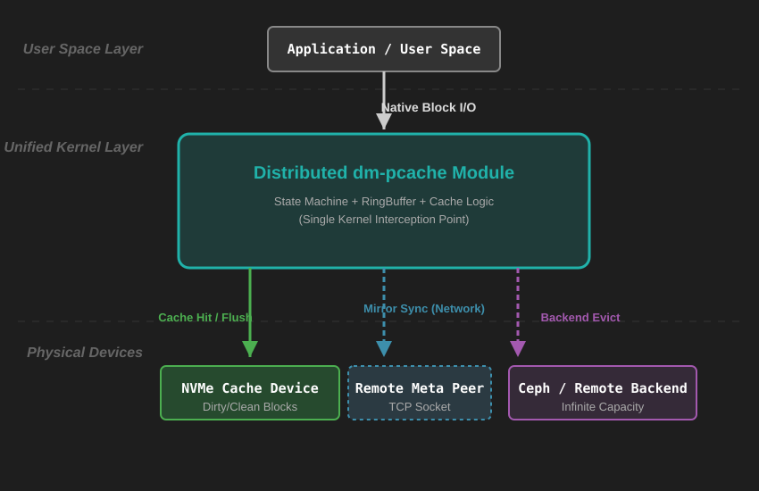
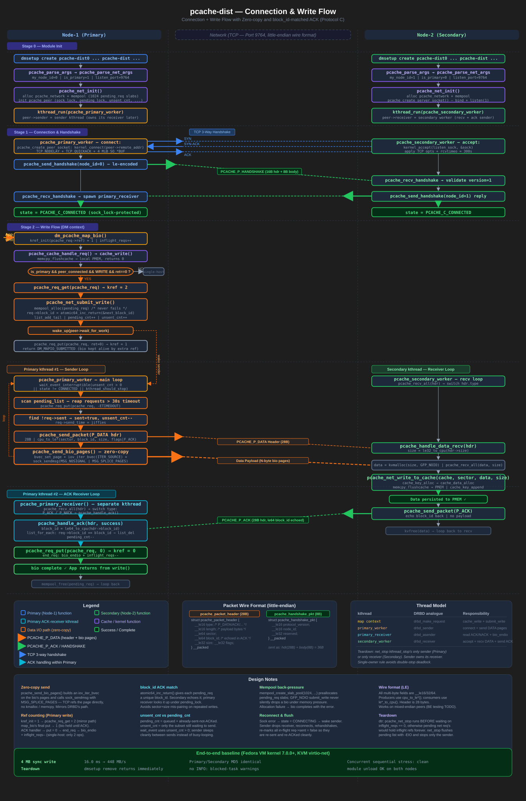
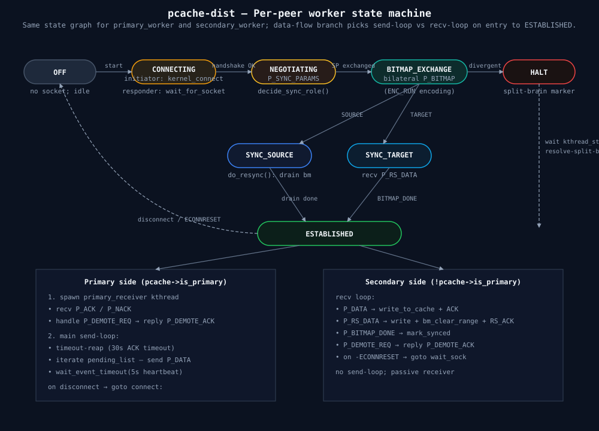
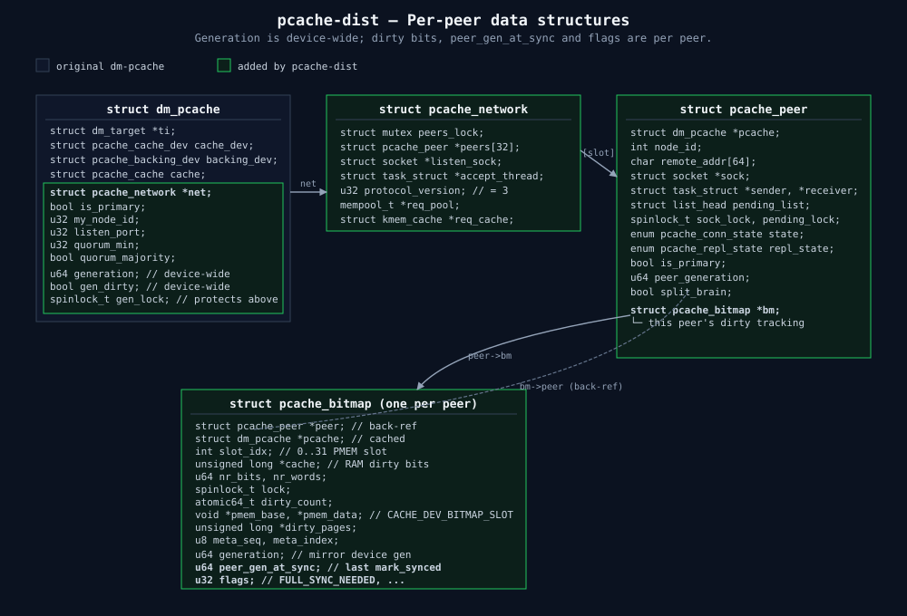
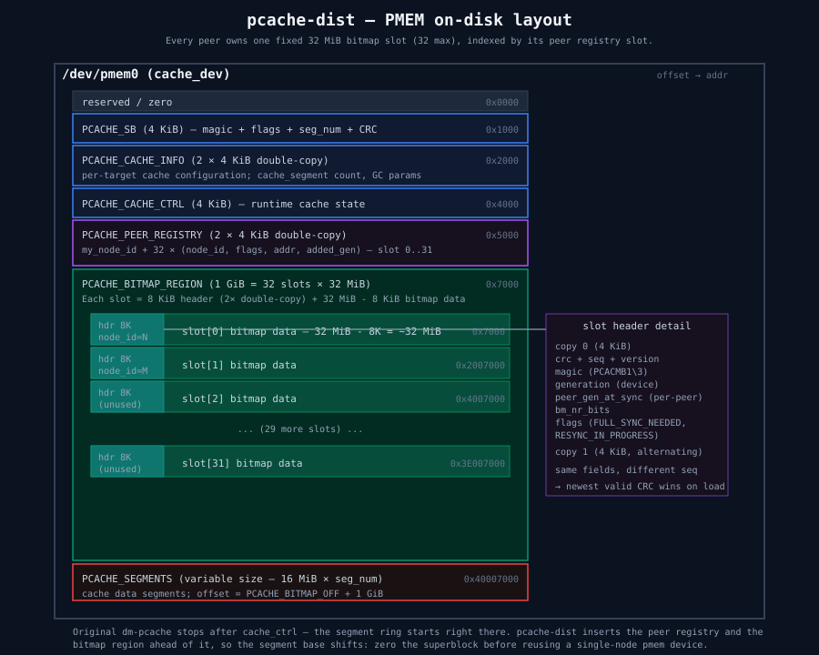
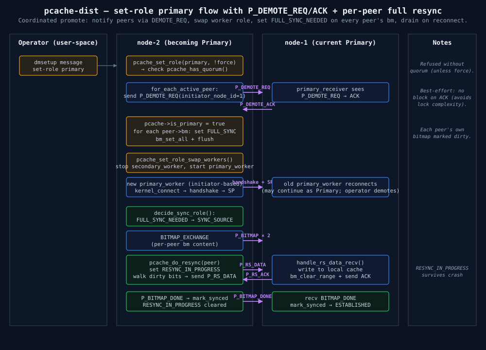
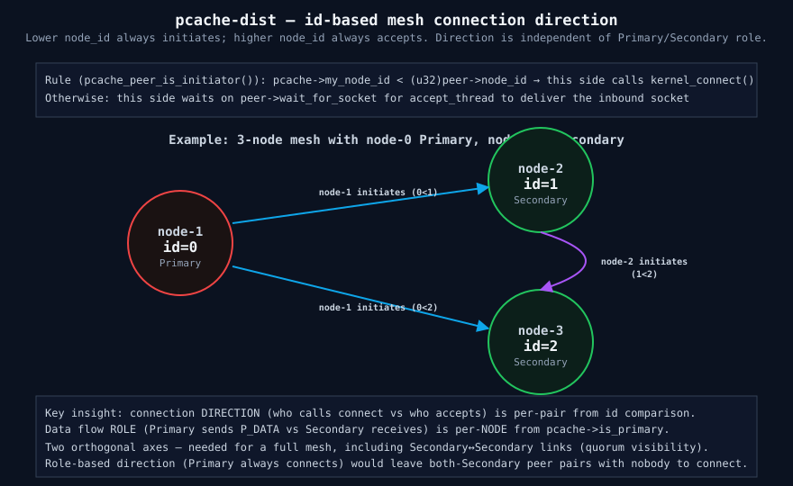

# pcache-dist 实现手册

`pcache-dist` 是在单机 `dm-pcache`（mainline 的 device-mapper 持久化写回缓存）之上扩展出来的**分布式同步复制**版本。
cache 设备既可以是 PMEM/DAX 设备，也可以是普通块设备（NVMe、virtio 盘、loop 等，称 BIO 后端），两种后端都支持复制（[§11](#11-缓存设备后端dax-与-bio)）。本手册直接对比**原版 dm-pcache** 与**当前 pcache-dist**，按**功能类别**说明新增了哪些东西、如何实现，供开发者独立阅读。

涉及的源码文件都在 `drivers/md/dm-pcache/` 目录下（只标文件名，不标行号 —— 行号易随代码变动而失效）。

本文只描述**当前行为**。配套文件：

| 文件 | 内容 |
|---|---|
| [`pcache-dist-fix-history.md`](./pcache-dist-fix-history.md) | 已修正缺陷的症状、根因、修正与验证 |
| [`dm-pcache-test-guide.md`](./dm-pcache-test-guide.md) | 测试工具与功能测试说明（`../tests/`） |
| [`pcache-dist-test-report.md`](./pcache-dist-test-report.md) | 测试报告：回归、压力、性能、整合中发现的问题 |
| [`bio-backend-integration.md`](./bio-backend-integration.md) | BIO 后端补丁系列的整合说明 |
| [`nvme-backend-design.md`](./nvme-backend-design.md) | BIO（原称 NVMe）后端的设计 |

## 目录

- [0. 基线：原版 dm-pcache 做什么](#0-基线原版-dm-pcache-做什么)
- [1. 总览：pcache-dist 新增了什么](#1-总览pcache-dist-新增了什么)
- [2. 跨节点同步复制](#2-跨节点同步复制)
- [3. 网络传输层](#3-网络传输层)
- [4. 脏区跟踪与增量重同步](#4-脏区跟踪与增量重同步)
- [5. 持久化元数据](#5-持久化元数据)
- [6. 高可用与角色管理](#6-高可用与角色管理)
- [7. Quorum 与脑裂安全](#7-quorum-与脑裂安全)
- [8. 运维接口](#8-运维接口)
- [9. 并发与锁](#9-并发与锁)
- [10. 术语表与符号索引](#10-术语表与符号索引)
- [11. 缓存设备后端：DAX 与 BIO](#11-缓存设备后端dax-与-bio)

---

## 0. 基线：原版 dm-pcache 做什么

原版 dm-pcache 是**单机**的 device-mapper target，把一块 PMEM/DAX 设备当作某个 backing 块设备的**持久化写回缓存**，on-media 采用 **log-structured（日志结构）**布局。理解下面几个概念就够读懂后续新增部分：

- **16 MiB segment 环 + 三指针**：PMEM cache 切成一串 16 MiB segment（`PCACHE_SEG_SIZE`，`cache_dev.h`）。写入是追加式的，三个持久化指针在环上依次追赶：

  | 指针 | 谁推进 | 语义 |
  |---|---|---|
  | `key_head` | 新写入 | 日志写入前沿，新 key/kset 追加于此 |
  | `dirty_tail` | writeback | 回写前沿，其后 dirty 数据已写回 backing |
  | `key_tail` | GC | 回收前沿，其后 segment 已释放复用 |

  不变式 `key_tail ≤ dirty_tail ≤ key_head`（环意义下）。**writeback 只推进 `dirty_tail`，不释放 segment；释放是 GC 的活**（`key_tail` 追上后 `cache_seg_put` 引用归零 → `cache_seg_invalidate`）。

- **kset 日志与索引树**：`req_key_tree` 是内存里按 4 MiB subtree 分片的 rbtree（非重叠 key 索引，读路径查 hit/miss）；一批 key（≤128，`PCACHE_KSET_KEYS_MAX`）打包成 **kset**（`pcache_cache_kset_onmedia`），`memcpy_flushcache` 落到 `key_head`，是崩溃恢复的日志单元。启动时 `cache_replay()` 从 `key_tail` 沿 kset 重放，重建索引树。

- **写入两阶段**（后续复制的接入点）：单机写被拆成 reserve + commit 两步 ——

  ```c
  /* cache_req.c —— 唯一可能返回 -EBUSY（cache 满）的步骤；不拷数据、不发网络 */
  int pcache_cache_write_reserve(cache, pcache_req, &keys);  /* 分配 key + 预留 PMEM 段空间 */
  /* cache_req.c —— 拷 bio→PMEM、插树、追加 kset */
  int pcache_cache_write_commit(cache, pcache_req, &keys);
  ```

原版 target 名是 `pcache`，本分支注册为 `pcache-dist`。以上单机核心（segment/kset/writeback/GC/replay）在 pcache-dist 中**原样保留**，下文全部是叠加在其上的**新增**能力。

原版只支持 DAX cache 设备，直接用 `memcpy_flushcache` 等原语访问映射。本分支并入的 BIO 后端系列把所有介质访问改成经 `cmedium_*` 接口，并为普通块设备实现了异步 bio 数据路径（[§11](#11-缓存设备后端dax-与-bio)）；上面的 `memcpy_flushcache` 等描述对 DAX 成立，BIO 上由对应的 bio 路径取代。

---

## 1. 总览：pcache-dist 新增了什么

pcache-dist 的所有新增都是**纯加法**，不改变单机核心的行为。区分点：

```c
/* dm_pcache.c —— 注册的 target 名改为 "pcache-dist"（原版是 "pcache"） */
static struct target_type dm_pcache_target = {
	.name		= "pcache-dist",
	.version	= {0, 1, 0},
	.map		= dm_pcache_map_bio,
	.status		= dm_pcache_status,
	.message	= dm_pcache_message,
	/* ... */
};
```

按功能类别，新增内容一览：

| 功能类别 | 新增了什么 | 主要文件 / struct |
|---|---|---|
| **跨节点同步复制**（[§2](#2-跨节点同步复制)） | Primary 写同步复制到 Secondary，本地 + 远端都落盘才回应（Protocol-C） | `dm_pcache.c` 写路径、`cache_req.c` Secondary 落盘 |
| **网络传输层**（[§3](#3-网络传输层)） | on-wire 协议、多 TCP-stream、refcounted socket、收发原语、复制线程模型 | `dm_pcache_protocol.h`、`dm_pcache_net.c/.h`、`dm_pcache_state.c` |
| **脏区跟踪与增量 resync**（[§4](#4-脏区跟踪与增量重同步)） | 每-peer 4 KiB/bit 脏位图、generation、断线只同步 delta、bitmap 交换 | `dm_pcache_bitmap.c/.h`、`dm_pcache_state.c` |
| **持久化元数据**（[§5](#5-持久化元数据)） | on-media 插入 registry 区 + bitmap 区、双拷贝 CRC、持久 peer 名录 | `cache_dev.h` 布局、`pcache_internal.h`、`dm_pcache_registry.c/.h` |
| **高可用与角色管理**（[§6](#6-高可用与角色管理)） | Primary/Secondary 角色、写围栏、在线切角色、协调式 demote、failover | `dm_pcache_state.c` |
| **Quorum 与脑裂安全**（[§7](#7-quorum-与脑裂安全)） | quorum 写围栏、split-brain 检测与人工裁决 | `dm_pcache_state.c` |
| **运维接口**（[§8](#8-运维接口)） | 分布式 table 参数、`dmsetup message` 控制面、扩展 status | `dm_pcache.c` |

**运行时门控**：整个分布式层由 `struct dm_pcache` 上一个指针决定（`dm_pcache.h`）：

```c
struct pcache_network *net;   /* NULL = 行为与原版单机逐字节一致；非 NULL = 跑复制 */
```

dmsetup table 里没有分布式参数时 `pcache_parse_dev_args` 返回 0、`pcache_net_init` 拆掉空 `net`（`dm_pcache_state.c`），target 退化为原版单机缓存。只有 table 同时给出 `my_node_id=` 与 `is_primary=` 时才启用复制。



> **图 1**：统一后的栈。上层 bio 进入单个 DM target；Primary 侧写本地 log-structured PMEM cache 的同时，把 payload 经 TCP 复制到 Secondary，Secondary 落进自己的同构 cache。

---

## 2. 跨节点同步复制

**目标**：每笔 WRITE 必须在**本地 cache 落盘**且**所有连接的 peer 都 ACK**后才向上层回应，任一节点宕机不丢数据（DRBD Protocol-C 语义）。

### 2.1 入口门控（`dm_pcache_map_bio`, dm_pcache.c）

分布式模式下 map 阶段先做两道 fence：

```c
/* —— 只有 Primary 能服务 WRITE，Secondary 写直接失败（否则重连制造脑裂） */
if (pcache->net && !pcache->is_primary && bio_data_dir(bio) == WRITE) {
	bio_io_error(bio);
	return DM_MAPIO_SUBMITTED;
}
/* —— Primary 失去 quorum 后拒写（见 §7） */
if (pcache->net && pcache->is_primary &&
    bio_data_dir(bio) == WRITE && !pcache_has_quorum(pcache)) {
	bio_io_error(bio);
	return DM_MAPIO_SUBMITTED;
}
```

### 2.2 本地写与网络发送重叠（`pcache_submit_req`, dm_pcache.c）

Primary 上、有 peer 连着的写走"重叠"快路径：**先 reserve 本地段空间，再 kick 网络发送，然后本地 commit 与 sender 并发跑**，把本地拷贝的时间藏进网络往返里：

```c
/* dm_pcache.c */
if (pcache->is_primary && bio_data_dir(bio) == WRITE &&
    bio->bi_iter.bi_size > 0 && pcache_peer_connected(pcache)) {
	ret = pcache_cache_write_reserve(&pcache->cache, pcache_req, &keys);  /* 只有这步会 -EBUSY */
	if (ret) return ret;                                                   /* cache 满 → defer，未发网络 */

	pcache_req_get(pcache_req);                       /* 跨网络 ACK 多持一个引用 */
	net_ret = pcache_net_submit_write(pcache, pcache_req,                  /* 异步发给 peer */
			bio->bi_iter.bi_sector, bio->bi_iter.bi_size);
	if (net_ret) {                                                        /* 入队失败：标脏待 resync */
		pcache_mark_all_peers_dirty(pcache, sector, size);
		pcache_req_put(pcache_req, net_ret);
	}
	ret = pcache_cache_write_commit(&pcache->cache, pcache_req, &keys);  /* 本地提交，与 sender 并发 */
	if (!ret && (bio->bi_opf & REQ_FUA) && cache_dev_is_bio(&pcache->cache_dev))
		ret = pcache_cache_flush(&pcache->cache);                       /* BIO 上 FUA 需要再 flush */
	return ret;
}
```

commit 阶段对每个 key 先标 `PCACHE_CACHE_KEY_FLAGS_WRITING`，再经 `cache_data_write_submit()` 提交数据：
DAX 上同步拷贝并当场完成；BIO 上提交一个异步 bio，完成时清掉 WRITING（读到 WRITING key 的请求会延后重试）。
请求在提交者上下文里处理（map 路径直接调用 `pcache_submit_req()`），只有 REQ_PREFLUSH、BIO 上的 FUA 写和
`-EBUSY` 重试才延后到 workqueue（这些需要等待，不能在 `submit_bio_noacct` 的递归保护下进行）。

因为 reserve（唯一会 `-EBUSY` 的步骤）在任何网络发送之前，cache 满被 defer 的写在重试成功时才复制，**不会双发或漏发**。bio 的最终完成由 `end_req`（`dm_pcache.c`）在**本地 commit 完成 + 每个 peer 的 ACK 都回来**后触发（`pcache_req` 的 kref 归零）。无 peer 连接时走普通单机路径，并 `pcache_mark_all_peers_dirty` 标脏，让 peer 重连后补齐。



> **图 2**：连接建立与复制写数据流。Primary reserve 后并发地"本地 commit"与"网络 send"，两路都完成才 `bio_endio`。

### 2.3 fan-out（`pcache_net_submit_write`, state.c）

对每个**可复制**的 peer 各建一个 `pcache_pending_req` 挂到选中 stream 的 `pending_list`（多 stream 分流见 [§3.3](#33-多-tcp-stream)）；其余 peer 直接 `pcache_bm_set_range` 标脏跳过：

```c
/* 有 socket 不等于能复制：streams[0]->pending_list 只在 primary_worker 的
 * ESTABLISHED 循环里被排空，协商期入队等于没人送。*/
static bool pcache_peer_can_replicate(struct pcache_peer *peer)
{
	return peer->state == PCACHE_C_CONNECTED &&
	       peer->repl_state == PCACHE_R_ESTABLISHED;
}

if (!pcache_peer_can_replicate(peer)) {
	if (peer->bm) pcache_bm_set_range(peer->bm, sector, size);  /* 标脏，由 resync 交付 */
	continue;
}
/* 可复制：分配 pending_req，第 2+ peer 追加 pcache_req_get（每 peer 独立 ACK → 独立 put） */
```

分配用**阻塞式** `GFP_NOIO`：资源不足时**节流，不拒绝**。跳过 peer 意味着把这笔写
从"已复制"静默降级成"欠债"，而链路健康时没有东西偿还它（[§9.6.1](#961-现存已知问题)）。
这段在 `peers_lock` **读侧**执行，睡眠只会延迟一个待处理的写者（add/remove-peer），
不会死锁。

> **注意** `pcache_has_quorum` 仍按**连接层**计数（`state == CONNECTED`），没有跟着
> 要求 ESTABLISHED —— 改了会让每次重连期间都触发写围栏，属于另一个语义决定。

### 2.4 ACK 处理（`pcache_handle_ack`, state.c）

Primary 收到 ACK/NACK 后按 `block_id` 在 `pending_list` 匹配，摘除并完成底层请求；**NACK 把该区在这个 peer 的 bitmap 标脏**，下次 resync 覆盖：

```c
if (!success)                                             /* NACK：peer 拒收 */
	pcache_bm_set_range(peer->bm, found->sector, found->size);
pcache_req_put(found->pcache_req, success ? 0 : -EIO);   /* 驱动 bio 完成 */
```

### 2.5 Secondary 落盘（`pcache_net_write_to_cache`, cache_req.c）

Secondary 的数据流线程收到 `P_DATA` 后，把裸 buffer 直接写进本地 cache（**不走 bio 路径**）。与 Primary 写不同：cache 满时不返回 `-EBUSY`，而是 `pcache_wait_seg` 在 `seg_wait_wq` 上**阻塞等 segment 释放**做背压：

```c
/* cache_req.c —— Secondary 侧背压：等 GC/writeback 释放段 */
while ((ret = cache_data_alloc(cache, key)) == -EBUSY) {
	if (pcache_is_stopping(pcache)) return -EIO;
	wait_event_interruptible_timeout(cache->seg_wait_wq,
		!cache->cache_full || pcache_is_stopping(pcache), HZ / 10);
}
```

每段做 reserve → 写数据 → 插树 → `cache_key_append`（`fua` 时强制 close kset，使元数据先落盘再 ACK）。

写数据一步按后端分：DAX 用 `memcpy_flushcache`；BIO 用同步 bio（`cache_dev_sync_kmem_io`）写完才插树，
所以读者看不到数据未落地的 key，也不需要 WRITING 标志，之后回的 ACK 就跟随设备完成（与 DRBD protocol C 一致）。
BIO 上的 FUA 写在所有分段之后再 `pcache_cache_flush()`，因为 BIO 的 kset close 只是 staged。`data_crc` 打开时，
这条路径从网络缓冲区计算 `key->data_crc`（不经过 `cache_data_write_submit()`）。
writeback 因错误停止后（[§11.6](#116-writeback-出错与--eio)），等 segment 的循环会放弃并返回 `-EIO`，
secondary 回 NACK 或断线，由 primary 标记该范围对端欠数据。

### 2.6 flush / FUA 屏障复制

`REQ_PREFLUSH`（fsync）是跨集群 durability barrier：Primary 本地 flush 后，把一个 `size=0 + F_FLUSH` 的 `P_DATA` 发到每个 peer 的**控制流**（`pcache_net_submit_flush`, `state.c`），peer 一次 flush 就 persist 它所有批量 kset，再回 ACK。否则用户 fsync 过的写在 Secondary 上是数据持久但元数据未持久（key 还在未 flush 的 kset），Secondary 崩溃会丢。`REQ_FUA` 则通过 `pending_req.fua` 让 peer 强制 close kset。

### 2.7 复制吞吐特征

多 TCP-stream（[§3.3](#33-多-tcp-stream)）在 `streams=2` 即可把单连接的调度串行点铺开到饱和跨节点往返；再加更多流无额外增益。持续大 I/O 写吞吐最终受单机核心的 **GC 段回收率**限制（回收速率 ≈ writeback 写回 backing 的速率，因为 GC 永远追不过 `dirty_tail`），这与是否复制无关 —— 无 peer 的单机写会撞到同一天花板。

---

## 3. 网络传输层

### 3.1 on-wire 协议（`dm_pcache_protocol.h`）

**协议版本 3**（`PCACHE_PROTO_VERSION`），默认端口 **9764**（`PCACHE_DEFAULT_PORT`）。多字节字段一律**小端**（`__le*`）。协议按能力递增：

| 版本 | 能力 |
|---|---|
| 1 | 基础复制：`HANDSHAKE / DATA / ACK / NACK`，每次重连全量 resync |
| 2 | 增量 resync：`+ SYNC_PARAMS / BITMAP / RS_DATA / RS_ACK / OUT_OF_SYNC / PING` |
| 3 | 协调式 promote/demote：`+ DEMOTE_REQ / DEMOTE_ACK` |

**两个正交状态维度**（`dm_pcache_protocol.h`）—— 连接层与复制子协议分开：

```c
enum pcache_conn_state {          /* TCP 连接层 */
	PCACHE_C_STANDALONE=0, PCACHE_C_CONNECTING=1, PCACHE_C_CONNECTED=2, PCACHE_C_DISCONNECTING=3,
};
enum pcache_repl_state {          /* 数据同步子协议（在 C_CONNECTED 之上） */
	PCACHE_R_OFF=0, PCACHE_R_NEGOTIATING=1, PCACHE_R_BITMAP_EXCHANGE=2,
	PCACHE_R_SYNC_SOURCE=3,        /* 本节点发 resync 数据 */
	PCACHE_R_SYNC_TARGET=4,        /* 本节点收 resync 数据 */
	PCACHE_R_ESTABLISHED=5,        /* 完全同步，正常 I/O */
	PCACHE_R_HALT=6,               /* split-brain 或致命不匹配 */
};
```

包类型与标志：

| 类型 | 值 | 用途 |
|---|---|---|
| `P_HANDSHAKE` | 0x00 | 连接建立，交换 node_id + stream_id |
| `P_DATA` | 0x01 | 复制写 payload（`size=0 + F_FLUSH` 时为 flush 屏障） |
| `P_ACK` / `P_NACK` | 0x02 / 0x03 | 写确认 / 拒绝（回 `block_id`） |
| `P_SYNC_PARAMS` | 0x10 | 交换 generation + bitmap 几何 |
| `P_BITMAP` / `P_BITMAP_DONE` | 0x11 / 0x12 | bitmap 分块 / 结束标记 |
| `P_RS_DATA` / `P_RS_ACK` | 0x13 / 0x14 | resync 数据块 / 确认 |
| `P_OUT_OF_SYNC` | 0x15 | 让 peer 标记某区脏 |
| `P_PING` / `P_PING_ACK` | 0x20 / 0x21 | keep-alive |
| `P_DEMOTE_REQ` / `P_DEMOTE_ACK` | 0x30 / 0x31 | 协调式 demote |

标志（`dm_pcache_protocol.h`）：`F_ACK` BIT(0)、`F_HANDSHAKE` BIT(1)、`F_FLUSH` BIT(2)、`F_FUA` BIT(3)。通用 32 字节头 `pcache_packet_header{type,length,sector,block_id,size,flags}`，后接各类型 payload（`pcache_handshake_pkt` / `pcache_sync_params_pkt` / `pcache_rs_data_pkt` / `pcache_bitmap_pkt` / `pcache_demote_pkt`）。

### 3.2 对象层级（`dm_pcache_net.h`）

```
pcache_network              (每 target 一个)
├── peers[PCACHE_BM_MAX_PEERS=32]     槽位与 registry / bitmap slot 索引对齐
│   └── pcache_peer         (每 peer 一个)
│       ├── state / repl_state              conn 与 repl 两维状态
│       ├── streams[PCACHE_MAX_STREAMS=4]   多 TCP 连接
│       │   └── pcache_stream    stream_id 0=控制, 1..=纯数据
│       │       ├── conn → pcache_conn  (kref+sock)  refcounted socket
│       │       ├── sender / receiver       两个 kthread
│       │       └── pending_list / pending_cnt / next_block_id
│       └── bm → pcache_bitmap              该 peer 的脏位图（§4）
├── listen_sock + accept_thread            单一监听 socket + accept kthread
└── req_pool (mempool)                     pcache_pending_req 分配池
```

### 3.3 多 TCP-stream

每个 peer 可开多条 TCP 连接：`streams[0]` 是**控制流**（承载 handshake / sync-params / resync，也带自己那份数据 shard），`streams[1..nr_streams-1]` 是**纯数据流**（`dm_pcache_net.h`）。写按 `hash_64(sector)` 分流，保证**同一区总走同一 stream**（保序）：

```c
/* state.c —— 先混淆再取模，避开 2 的幂步长（如 128K=256 sector）塌缩到同一流 */
s = 0;
if (peer->nr_streams > 1) {
	s = (u32)(hash_64(sector, 32) % (u32)peer->nr_streams);
	if (s && !READ_ONCE(peer->streams[s].conn))   /* 选中流未连 → 回落控制流 0 */
		s = 0;
}
```

`nr_streams == 1` 时逐字节退化为旧单连接行为。上限 `PCACHE_MAX_STREAMS = 4`，由 table 参数 `streams=N` 设定。

### 3.4 refcounted socket（`pcache_conn`）

为避免线程碰到已释放的 socket，每个 stream 的 socket 用 kref 包成 `pcache_conn`（`dm_pcache_net.h`）：

```c
struct pcache_conn { struct kref ref; struct socket *sock; };
```

用 socket 的线程先 `pcache_conn_get()` 持引用做阻塞 recv/send；teardown 时 `pcache_conn_drop()` 把 conn 从 stream 摘下、`shutdown` 唤醒阻塞者、再放安装引用。**最后一个引用归零才真正释放 socket**（`dm_pcache_net.c`），因此快速重连/拆建下也不会 use-after-free。

### 3.5 收发原语（`dm_pcache_net.c`）

| 函数 | 作用 |
|---|---|
| `pcache_send_all` / `pcache_recv_all` | 完整收发 N 字节（处理短读短写） |
| `pcache_create_peer_socket` | 主动 connect |
| `pcache_connect_data_stream` | 建立第 1..N 条数据流 |
| `pcache_create_listen_socket` | 建监听 socket（`PCACHE_SOCK_BUF_BYTES` = 4 MiB 收发缓冲） |
| `pcache_send/recv_handshake` | 交换 node_id + stream_id |
| `pcache_send/recv_sync_params` | 交换 generation + 几何 |
| `pcache_send_bio_pages` | 用 `MSG_SPLICE_PAGES` 零拷贝把 bio 各 page 发出 |
| `pcache_send_demote_req/ack` | 协调 demote |

ACK 超时 `PCACHE_ACK_TIMEOUT_SECS = 30`（`dm_pcache_net.h`）；socket 设 TCP keepalive（idle 20s / intvl 10s / cnt 3，`pcache_apply_socket_opts`），静默死链最坏 ~50s 检出。

### 3.6 线程模型（`dm_pcache_state.c`）

| kthread | 角色 | 所属 |
|---|---|---|
| `pcache_accept_thread` | 拥有 listen socket，accept 入站，按 `(node_id, stream_id)` 派发到 stream slot | 每 network 一个 |
| `pcache_primary_worker` | Primary 侧总控：连 peer、握手、协商、驱动复制 | 每 peer |
| `pcache_primary_receiver` | Primary 控制流收 ACK/NACK → `pcache_handle_ack` | 每 peer 控制流 |
| `pcache_secondary_worker` | Secondary 侧总控：接受连接、握手、收数据落盘 | 每 peer |
| `pcache_data_sender` | 数据流发送端：drain `pending_list` 推 socket | 每数据流 |
| `pcache_data_receiver` | Primary 数据流收 ACK | 每数据流 |
| `pcache_data_secondary` | Secondary 数据流收 `P_DATA` → 落盘 | 每数据流 |

**控制流 vs 数据流的分工**：控制流 `streams[0]` 的收发由 per-peer 总控线程负责（Primary 侧 `pcache_primary_worker` 发 + `pcache_primary_receiver` 收 ACK，Secondary 侧 `pcache_secondary_worker`）。数据流 `streams[1..nr_streams-1]` 才各起自己的 `pcache_data_sender`/`pcache_data_receiver`（Primary）或 `pcache_data_secondary`（Secondary）—— 由 `pcache_data_stream_start` 拉起，且只对数据流（`for i=1..nr_streams-1`）。因此 `streams=1`（默认）时没有数据流线程，全部复制走控制流。`pcache_stream_fault` 在 socket 出错时标记该流故障并唤醒等待者。



> **图 3**：每-peer worker 线程的状态与迁移。accept 派发 socket 后，worker 进入握手 → 协商 →（可选 resync）→ ESTABLISHED 的稳定复制循环。

---

## 4. 脏区跟踪与增量重同步

**目标**：peer 断线期间 Primary 的写要被记下来，重连时**只同步差异（delta）**而非全量。做法是 DRBD Activity-Log 式的脏区位图。

### 4.1 每-peer 脏位图（`dm_pcache_bitmap.c/.h`）

- **每个 peer 拥有独立 `pcache_bitmap`**（`pcache_peer.bm`），粒度 `PCACHE_BM_BLOCK_SHIFT = 12` → **4 KiB/bit**。
- 每位图占 registry 决定的 **slot**：`bm->slot_idx` = registry 槽位，`pmem_base = CACHE_DEV_BITMAP_SLOT(cdev, slot_idx)`（`dm_pcache_bitmap.h`）。
- 结构：RAM working copy `cache` + PMEM slot 双拷贝 header（`pcache_bm_header_onmedia`，magic `PCACHE_BM_MAGIC`）+ `dirty_pages`（提示式回刷，只把变化的 4 KiB 页写回 PMEM）。

| 函数 | 作用 |
|---|---|
| `pcache_peer_bitmap_init` | 按 backing sectors + slot 建位图，从 PMEM header 加载 gen |
| `pcache_bm_set_range` / `clear_range` | 置/清脏（写复制失败、NACK、无 peer 时置脏） |
| `pcache_bm_find_next_dirty` | resync 扫描：找下一段连续脏 bit |
| `pcache_bm_mark_synced` | 进入 ESTABLISHED 时记录 peer gen，并（若无其它 peer 更超前）清 device 级 `gen_dirty` |
| `pcache_bm_flush_sync` / `_header_flush` | 位图 / header 持久化到 PMEM slot |



> **图 4**：每-peer 数据结构。peer → bitmap（RAM copy + PMEM slot）→ registry slot 的绑定；device 级 generation 被各 peer slot 镜像。

### 4.2 generation 簿记

device 级 `generation` 在 `struct dm_pcache`（`dm_pcache.h`，`gen_lock` 保护）。语义：任一 peer 自上次 `mark_synced` 后**首次**出现新脏 bit（`gen_dirty` false→true）时**才** bump generation；任一 `mark_synced` 复位 `gen_dirty`。每个 peer bitmap 的 header 各自镜像一份 device gen 做恢复冗余。generation 的单调推进是下面判定 resync 方向的依据。

### 4.3 握手与同步方向协商（`decide_sync_role`, state.c）

连接建立后立刻交换 `SYNC_PARAMS`，由**双方 generation 比较**决定谁发谁收 —— 这也是 **split-brain 检测点**：

```c
static enum pcache_repl_state pcache_decide_sync_role(peer, peer_sp)
{
	/* 1. 几何不符（bit 数 / block_shift 不一致）→ 立即 HALT */
	if (peer_sp->bm_nr_bits != bm->nr_bits || peer_sp->bm_block_shift != 12)
		return PCACHE_R_HALT;
	/* 2. 全新启动（任一方需全量）：Primary 主导首次全量同步 */
	if (my_need || peer_need)
		return primary ? PCACHE_R_SYNC_SOURCE : PCACHE_R_SYNC_TARGET;
	/* 3. clean 重连：双方 gen 互相印证 → 直接 ESTABLISHED */
	if (my_gen == peer_gen && my_peer_gen == peer_gen && peer_my_gen == my_gen)
		return PCACHE_R_ESTABLISHED;
	/* 4. 我更新：对端对自己的认知 == 我记下的它的快照 → 我当 SOURCE */
	if (my_gen > peer_gen && peer_gen == my_peer_gen)
		return PCACHE_R_SYNC_SOURCE;
	/* 5. 对端更新：对称 → 我当 TARGET */
	if (peer_gen > my_gen && my_gen == peer_my_gen)
		return PCACHE_R_SYNC_TARGET;
	/* 6. 同代但互证断裂 / 无关链 → split-brain，HALT */
	return PCACHE_R_HALT;
}
```

协商链：`pcache_exchange_sync_params`（initiator=低 node_id 先发）→ `decide_sync_role` → 若需同步则 `pcache_exchange_bitmaps`。

### 4.4 增量 resync 与 bitmap 交换

- **增量 resync**（`pcache_do_resync`, state.c）：`while pcache_bm_find_next_dirty` → **清该段脏位** → 读 backing → 送 `P_RS_DATA` → 收 `P_RS_ACK`。Secondary 侧 `pcache_handle_rs_data_recv`写入 cache 并清自己 bitmap。四点值得注意：

  | 机制 | 为什么 |
  |---|---|
  | 开头 `pcache_cache_flush()` 后再 `pcache_cache_writeback_all()` | 本循环读的是 **backing**，而 `pcache_cache_flush` 只 close kset（元数据→PMEM），不回写 backing。少了这步会发出陈旧块 |
  | 每个 chunk 前复查 cache 是否干净 | resync 期间的写会持续弄脏 cache；已干净时只花一次 PMEM kset 读 |
  | **先清脏位再读**，而非 ACK 后才清 | 否则"读之后才写入"所设的脏位会被清掉，那份数据既没发出也不再被记为欠账。clear 与 ACK 之间每条错误路径都会恢复该范围 |
  | 多趟扫描，只有真正清空才 `mark_synced` | cursor 单调前进，被并发写重新弄脏、位于其后方的区域需下一趟才捞得回；某趟无进展即停，避免追不上写手时空转 |

  代价：慢链路 + 持续写下 resync 会明显变长（每趟≈chunk 数 × RTT）。
- **bitmap 交换**（重连时双方合并脏区）：`pcache_send_bitmap_full`用 `pcache_send_bitmap_run`（连续 set-bit 段用 RUN 编码免 payload）逐段送出，`pcache_recv_bitmap_merge`对每段 `pcache_bm_set_range`。

---

## 5. 持久化元数据

**目标**：跨重启保持"哪个 slot 属于哪个 peer 的位图"，以及元数据的抗损坏能力。

### 5.1 on-media 布局（在 segments 前插入两个新区）

分布式层在 cache_ctrl 与 segments 之间插入了 **peer registry 区** 和 **bitmap 区**（`cache_dev.h`）。因此在已有单机数据上启用分布式布局，必须**先 zero superblock 再重建**（新区会推移 segment 基址）：

```
偏移 (cache_dev.h)                    大小                       说明
─────────────────────────────────────────────────────────────────────────────
PCACHE_SB_OFF            = 4 KiB       4 KiB                      superblock
PCACHE_CACHE_INFO_OFF                  4 KiB × 2 (双拷贝)         cache_info
PCACHE_CACHE_CTRL_OFF                  4 KiB                      cache_ctrl (log 三指针持久化)
PCACHE_PEER_REGISTRY_OFF              8 KiB (= 4 KiB × 2)         ← 新增：peer registry 区（双拷贝）
PCACHE_BITMAP_OFF                     1 GiB (= 32 × 32 MiB)       ← 新增：bitmap 区（每 peer 一 slot）
PCACHE_SEGMENTS_OFF                   N × 16 MiB                  segment 环
```

- **`PCACHE_BM_MAX_PEERS = 32`**（`cache_dev.h`）。
- 每 bitmap slot = 32 MiB（`PCACHE_BITMAP_SLOT_SIZE`），按 4 KiB/bit 覆盖约 **4 TiB backing/peer**。
- 定位用字节偏移：`PCACHE_PEER_REGISTRY_OFF`、`PCACHE_BITMAP_SLOT_OFF(slot)`（`cache_dev.h`），经 `cmedium_*` 访问，
  DAX 与 BIO 通用（registry 结构里是 `base_off`，bitmap 是 `base_off` / `data_off`）。
- 这个布局在 BIO 后端上同样存在，因此 BIO cache 设备至少要约 1.3 GiB（1 GiB bitmap 区 + segment）。
- superblock（`struct pcache_sb`）由 BIO 后端系列加了 `block_size` 与 `cache_type`（DAX/BIO）两个字段，crc 覆盖整个结构；
  旧模块格式化的超级块会校验失败，必须重新格式化（先清零超级块）。



> **图 5**：PMEM on-disk 布局。registry 区（双拷贝）后紧跟 32 个固定 32 MiB bitmap slot，slot 索引与 registry 槽位一一对应，再往后才是 16 MiB segment 环。

### 5.2 双拷贝 + seq + CRC 冗余

所有 on-media 元数据块（SB、cache_info、registry、bitmap header、cache_seg_ctrl）用同一套**双拷贝方案**（`pcache_internal.h`）：每块前缀 `pcache_meta_header{crc,seq,version}`，写时在 `PCACHE_META_INDEX_MAX = 2` 个槽间交替、`seq` 递增；读时取 **CRC 有效且 seq 最新**的那份：

```c
/* pcache_internal.h —— 选出最新有效元数据副本 */
void *pcache_meta_find_latest(header, meta_size, meta_max_size, meta_ret)
{
	for (i = 0; i < PCACHE_META_INDEX_MAX; i++) {           /* 遍历 2 个副本 */
		copy_mc_to_kernel(meta, header + i*meta_max_size, meta_size);  /* MC-safe 读 */
		if (meta->crc != pcache_meta_crc(meta, meta_size))  /* CRC 不符 = 损坏，跳过 */
			continue;
		if (!latest || pcache_meta_seq_after(meta->seq, seq_latest))   /* seq 环回安全比较 */
			latest = meta_addr;
	}
	return latest;   /* NULL = 两份都无效 */
}
```

`pcache_meta_seq_after` 用 8-bit 有符号差处理 seq 环回，CRC 种子 `PCACHE_CRC_SEED = 0x3B15A`。因此归零任一份拷贝后，设备仍能经存活的另一份加载、数据不丢。

### 5.3 持久 peer 注册表（`dm_pcache_registry.c/.h`）

把 `(node_id, addr, generation)` 按 bitmap slot 持久化在 PMEM，使 **slot↔bitmap 归属跨重启保持**（否则重启后无法把 PMEM 上的脏位图对回正确的 peer）：

- PMEM 双拷贝 header + 32 个 `pcache_peer_entry_onmedia`（各 96 字节）：`node_id / flags(IN_USE|TOMBSTONE) / added_generation / addr[64]("ip:port")`，magic `PCACHE_PEER_REG_MAGIC`。
- API：`pcache_registry_init/add/remove/find_slot_by_node_id/slot_in_use`。remove 打 TOMBSTONE（软删，slot 可被回收）。

registry 在 ctr 里**总是**初始化（即便单机模式），保证布局稳定（`dm_pcache.c`）。`add-peer` 经 `pcache_add_peer` → `pcache_registry_add` 落一个 slot，再 `pcache_peer_bitmap_init` 在同 slot 建位图。**注意**：registry 只持久化归属关系，设备重启后不自动重连 peer —— 仍需 `add-peer` 重新建立连接（该操作是幂等的：`find_slot_by_node_id` 命中即复用旧 slot）。

**重加入的 peer 拿到的是全新位图。** `pcache_peer_bitmap_init` 有个 `force_fresh`
参数，`pcache_add_peer` 在经 `pcache_registry_add()` 取得槽位时（首次加入，或
`remove-peer` 之后的重加入）传 `true`：

| 情形 | 位图 | 结果 |
|---|---|---|
| 重挂**仍存活**的 registry 条目（设备重建、registry 从 PMEM 恢复）| 载入持久化位图 | 增量 resync —— 这正是持久化 registry 的意义 |
| 经 `registry_add` 取得槽位（首次 / remove 后重加入）| **fresh + `FULL_SYNC_NEEDED`** | 全量同步 |

必须如此：`remove-peer` 会销毁该 peer 的脏跟踪，但**槽位里的 PMEM 位图还在**。
若照旧载入，就会复活一段已不存在关系的 generation 簿记，
`decide_sync_role`（[§4.3](#43-握手与同步方向协商decide_sync_role-statec)）的互证
条件随之断裂，判成一个从未发生过的 split-brain。瞬时断连不受影响 —— peer 仍在册，
走的是增量。

---

## 6. 高可用与角色管理

### 6.1 角色与写围栏

`pcache->is_primary` 由 table 的 `is_primary=0|1` 初始化。分布式模式下只有 Primary 服务 WRITE；Secondary 写被 `dm_pcache_map_bio` 直接 `bio_io_error`（[§2.1](#21-入口门控dm_pcache_map_bio-dm_pcachec)）—— 防止两个可写节点在重连时制造脑裂。

### 6.2 在线切角色 + worker 切换

`dmsetup message set-role primary|secondary [force]` → `pcache_set_role`（`state.c`）在线切角色；`pcache_set_role_swap_workers`负责把 primary/secondary worker 线程对调起停并重新握手。

### 6.3 协调式 demote

promote 前用 `P_DEMOTE_REQ`（0x30）请对方先 demote，对方 demote 完回 `P_DEMOTE_ACK`（0x31），避免两个 Primary 并存。收发原语 `pcache_send_demote_req/ack` / `pcache_recv_demote_body`（`dm_pcache_net.c`）。

### 6.4 failover

Primary 宕机后，运维把某 Secondary `set-role primary force` 提升为新 Primary 继续服务；原节点恢复后以 Secondary 身份重新 `add-peer` 加入，再由 generation 定向的 resync 拉齐。



> **图 6**：promote → resync 流程。demote 握手确保单 Primary，随后按 generation 定向的 resync 把新 Primary 与各 Secondary 拉齐。



> **图 6b**：多 peer（N≤32）mesh 的连接方向约定（低 node_id 主动 connect 高 node_id），避免双向重复建连。

---

## 7. Quorum 与脑裂安全

### 7.1 quorum 写围栏

`pcache_has_quorum`（`state.c`）：`connected(含自己) ≥ threshold`，`threshold` 为配置的 `quorum_min` 或 `majority` 时 `(total/2)+1`。Primary 失去 quorum 后 `dm_pcache_map_bio` 直接拒写，防止孤立 Primary 继续接受不可复制的写。由 table 参数 `quorum=off|majority|N` 设定（默认 off = 1 = 关闭）。

### 7.2 split-brain 检测与裁决

`decide_sync_role`（[§4.3](#43-握手与同步方向协商decide_sync_role-statec)）在"同代但互证断裂 / 无关代链"时返回 `PCACHE_R_HALT`，并在该 peer 上置 `split_brain` 标记（`dm_pcache_net.h`），复制停摆，等待人工裁决。**安全保证**：分歧数据不会被静默覆盖，复制保持停摆，直到运维介入。

人工恢复（`pcache_resolve_split_brain`, `state.c`）：

```
dmsetup message <dev> 0 resolve-split-brain <peer_node_id> victim    # 本地作牺牲方（丢弃本地差异，全量收）
dmsetup message <dev> 0 resolve-split-brain <peer_node_id> survivor  # 本地作幸存方（保留本地，全量发）
```

相关：`abort-resync`中止进行中的 resync；`reset-generation`重置代号（危险，仅在确知数据一致时用）。

---

## 8. 运维接口

### 8.1 dmsetup table 语法

```
0 <sectors> pcache-dist <cache_dev> <backing_dev> \
    [<n> cache_mode writeback data_crc <true|false>] \
    [my_node_id=<id> is_primary=<0|1> listen_port=<port> quorum=<off|majority|N> streams=<1..4>]
```

- 单机（与原版等价）：`pcache-dist /dev/pmem0 /dev/loopX`。
- `<cache_dev>` 可以是 DAX 设备（`/dev/pmem0`）或普通块设备（`/dev/nvme0n1`、`/dev/vdb`、loop 等）；
  后端在 ctr 时按设备是否支持 DAX 自动选择，记录在超级块的 `cache_type` 里（[§11.2](#112-后端选择与超级块)）。
- 分布式：需同时给出 `my_node_id=` 与 `is_primary=`，否则判为非分布式模式（`state.c`）。
- cache-opts 组以整数计数开头；解析器用"首个剩余 arg 是否整数"区分 cache-opts 与 net-args（`dm_pcache.c`），因此 `key=value` 形式的 net-args 会被正确识别。
- **peer 不写在 table 里**：运行时用 `add-peer` 消息（`peer_addr=` 已废弃）。
- `streams` 1..4；`listen_port` 默认 9764。

建栈示例（node-1 = Primary, node-2 = Secondary）：

```bash
# node-1 (Primary)
dmsetup create pc --table "0 $SZ pcache-dist /dev/pmem0 /dev/loop0 my_node_id=1 is_primary=1 listen_port=9764 streams=2"
dmsetup message pc 0 add-peer 2 <node-2 IP>:9764
# node-2 (Secondary)
dmsetup create pc --table "0 $SZ pcache-dist /dev/pmem0 /dev/loop0 my_node_id=2 is_primary=0 listen_port=9764 streams=2"
dmsetup message pc 0 add-peer 1 <node-1 IP>:9764
```

### 8.2 运行时控制（`dmsetup message`, dm_pcache.c）

| 消息 | 参数 | 作用 |
|---|---|---|
| `gc_percent <0..N>` | 1 | GC 触发水位（命中率旋钮） |
| `writeback_percent <0..90>` | 1 | lazy-writeback 水位；0 = eager（默认） |
| `bitmap-status` | 0 | device gen/gen_dirty + 每 peer 脏计数 |
| `force-resync` | 0 | 强制对所有 peer 全量重同步 |
| `add-peer <id> <ip:port>` | 3 | 运行时加 peer（幂等） |
| `remove-peer <id>` | 2 | 移除 peer（打 TOMBSTONE） |
| `list-peers` | 1 | 列出 peer 摘要 |
| `set-role primary\|secondary [force]` | 2-3 | 在线切角色 |
| `resolve-split-brain <id> victim\|survivor` | 3 | 人工裁决 split-brain |
| `abort-resync` | 1 | 中止进行中的 resync |
| `reset-generation` | 1 | 重置代号（危险） |

### 8.2.1 故障注入（模块参数）

仿 DRBD 的 `drbd_insert_fault` / `fault_rate` / `fault_types`。默认全关。

| 参数 | 说明 |
|---|---|
| `fault_rate` | 命中概率（百分比），`0` = 关闭 |
| `fault_types` | 注入点位掩码：`1` = Secondary 收 `P_DATA` 落盘、`2` = Secondary 收 `P_RS_DATA` 落盘 |
| `fault_count` | 只读，已注入次数 |

```bash
echo 30 > /sys/module/dm_pcache/parameters/fault_rate
echo 1  > /sys/module/dm_pcache/parameters/fault_types
cat       /sys/module/dm_pcache/parameters/fault_count
echo 0  > /sys/module/dm_pcache/parameters/fault_rate   # 关闭
```

选这两个注入点，是因为它们是**唯二会让 Secondary 拒收一笔写**的路径（NACK 与
resync 失败），而这两条路径的错误处理此前只能靠"`dmsetup remove` 与实时 I/O 竞速"
才碰得到。回归用例见测试指南 Section 11。

`fault_rate = 0` 时 `pcache_should_fail()` 只是一个可预测分支，钩子常驻无可测代价。

### 8.3 状态查询（`dmsetup status`, dm_pcache.c）

STATUSTYPE_INFO 输出：`sb_flags seg_num n_segs seg_used gc_percent cache_flags key_head(seg:off) dirty_tail(seg:off) key_tail(seg:off)`，分布式模式再追加 `bm_gen=<gen> bm_dirty=<sum>/<max>`（所有 active peer 脏 bit 之和 = 复制欠债）。三指针的 seg:off 可直接观察 §0 的回收/回写/写入前沿距离。

debugfs（`/sys/kernel/debug/dm-pcache/<major:minor>/stats`，需 `CONFIG_DEBUG_FS`）给出更细的运行状态：
`cache_dev_type`（dax/bio）、各层 in-flight 请求数、数据与元数据写的 submitted/completed/inflight、
segment 占用与 `cache_full`、三指针、`gc_errors`、`writeback_errors`、读未命中 promote 计数。
排查 BIO 上的停顿时最有用的是：`cache_full`、`dirty_tail` 是否前进、`writeback_errors`。

### 8.4 构建与部署

只编单模块、不 `modules_install`：

```bash
cd <kernel-source-tree>
make M=drivers/md/dm-pcache modules
modinfo drivers/md/dm-pcache/dm-pcache.ko | grep vermagic     # 确认与目标机内核匹配
scp drivers/md/dm-pcache/dm-pcache.ko root@<node>:/root/
```

目标机加载：`insmod /root/dm-pcache.ko`；`dmsetup targets | grep pcache-dist` 验证。**复用同一 pmem 前务必 zero superblock**（否则 `sb_validate` 失败），启用分布式布局尤其如此（[§5.1](#51-on-media-布局在-segments-前插入两个新区)）：

```bash
python3 -c "import os; fd=os.open('/dev/pmem0',os.O_RDWR); os.lseek(fd,0x1000,0); os.write(fd,b'\\x00'*4096); os.close(fd)"
```

清理顺序：`dmsetup remove` → `rmmod dm_pcache` → `losetup -d` → 删 backing 文件。多节点时先在次要节点操作。

---

## 9. 并发与锁

分布式层新增了 6 个同步原语，叠加在原版单机核心自己那套锁之上 —— 一笔复制写会**同时穿过两套**。本节列出每把锁保护什么、谁获取、以及它们之间的获取顺序。

### 9.1 pcache-dist 新增的锁

| 对象（所在 struct） | 原语 | 保护的状态 | 获取者 |
|---|---|---|---|
| `pcache_network.peers_lock` | percpu_rwsem | `peers[]` 槽位的增、删、遍历；**读侧持有期间 peer 结构不会被释放** | **读**：写 fan-out、`pcache_peer_connected`、`pcache_has_quorum`、`mark_all_peers_dirty`、status / list-peers / bitmap-status；**写**：add/remove-peer、set-role、force-resync、abort-resync、reset-generation、resolve-split-brain、accept 派发、net_stop |
| `pcache_stream.sock_lock` | spinlock | `stream->conn` 指针本身（install / drop / get 的切换） | 只在 `pcache_conn_*` helper 内部 |
| `pcache_stream.pending_lock` | spinlock | `pending_list` 链表 + `pending_cnt` | fan-out 入队、sender 挑未发件、ACK 摘除、flush 排空 |
| `pcache_bitmap.lock` | spinlock | 位图 RAM 副本 `cache`、`dirty_pages`、`flags` | `bm_set_range` / `clear_range`、`find_next_dirty`、flush |
| `dm_pcache.gen_lock` | spinlock | `generation`、`gen_dirty`，以及 `bm->generation` 镜像 | `bm_set_range`、`mark_synced`、`reset-generation`、`set-role` |
| `pcache_peer_registry.lock` | mutex | registry `entries[]` 与其 PMEM 双拷贝写 | add/remove-peer |

**命名撞车提醒**：源码里有**两个** `gen_lock`，分属不同层，读代码时不要混淆 ——

- `pcache->gen_lock`（`dm_pcache.h`）：分布式**数据 generation**（[§4.2](#42-generation-簿记)），resync 方向与 split-brain 判定用。
- `cache_seg->gen_lock`（`cache.h`）：原版**每段 gen**，读路径判断该段是否已被 GC 复用用。

### 9.2 原版单机核心的锁（未改动）

复制写最终会落到 `pcache_cache_write_reserve/_commit`，因此也会碰到原版这套：

| 对象 | 原语 | 保护的状态 |
|---|---|---|
| `pcache_cache_subtree.tree_lock` | spinlock | 该 4 MiB 分片的 rbtree —— 索引树的并发度就来自分片 |
| `pcache_cache.key_head_lock` | spinlock | `key_head` 日志写前沿 |
| `pcache_cache.key_tail_lock` / `dirty_tail_lock` | mutex | GC / writeback 前沿及其 PMEM ctrl 持久化 |
| `pcache_cache.writeback_lock` | mutex | 一轮 writeback 的 kset 缓冲与 key tree |
| `pcache_cache.seg_map_lock` | spinlock | 段分配位图 `seg_map`、`cache_full` |
| `pcache_cache_kset.kset_lock` | spinlock | 该 kset 的 on-media 缓冲（攒 ≤128 个 key 再落盘） |
| `pcache_cache_segment.gen_lock` | spinlock | 段 `gen` / `gen_seq` |
| `pcache_cache_dev.seg_lock` | mutex | cache_dev 级段分配 bitmap |
| `pcache_backing_dev.submit_lock` / `complete_lock` | spinlock | backing 请求的提交 / 完成链表 |
| `cache_info_lock` / `pcache_cache_segment.info_lock` | mutex | 各自 on-media info 块的双拷贝写 |

### 9.3 锁层级（获取顺序）

代码中实际出现过的嵌套只有这几条，**从外到内**：

```
net->peers_lock  (percpu_rwsem)
├── reg->lock         (mutex)   add-peer / remove-peer 落 registry     [写侧]
├── st->pending_lock  (spin)    fan-out 入队                           [读侧]
└── bm->lock          (spin)    给断开的 peer 标脏                     [读侧]
```

**读侧可以睡眠**：`peers_lock` 是 percpu_rwsem，fan-out 与 flush 都在读侧用阻塞的
`mempool_alloc(GFP_NOIO)`。睡在这里只会延迟一个待处理的写者（add/remove-peer），
不会死锁。**刻意选择节流而非拒绝**：跳过一个 peer 等于把这笔写从"已复制"静默降级
成"欠债"，代价远高于一条管理命令偶尔变慢（[§2.3](#23-fan-outpcache_net_submit_write-statec)、
[§9.6.1](#961-现存已知问题)）。

另有两条重要的**非**嵌套约定：

**`gen_lock` 不嵌在 `bm->lock` 里** —— `pcache_bm_set_range` 是先放开位图锁、再拿 gen_lock，两把**顺序获取**：

```c
/* dm_pcache_bitmap.c —— 两把锁不重叠 */
spin_lock(&bm->lock);
/* ... 置位 + 标记脏页 ... */
spin_unlock(&bm->lock);                   /* 先放开 */

if (delta && pcache) {
	spin_lock(&pcache->gen_lock);     /* 再拿另一把 */
	if (!pcache->gen_dirty) {         /* 自上次 mark_synced 起首个新脏位才 bump */
		pcache->gen_dirty = true;
		pcache->generation++;
	}
	bm->generation = pcache->generation;   /* 注意：此字段由 gen_lock 保护，不是 bm->lock */
	spin_unlock(&pcache->gen_lock);
}
```

**`sock_lock` 是叶子锁** —— 只在 `pcache_conn_*` 内部短暂持有，且**不得**在持有它时调用 conn helper（helper 自己会加锁，源码对此有明文注释）。

### 9.4 一笔复制写穿过的锁

Primary 侧一笔 WRITE 依次碰到：

| 步骤 | 锁 | 说明 |
|---|---|---|
| `dm_pcache_map_bio` → `pcache_has_quorum` | **默认不加锁** | `quorum=off`（默认，`quorum_min==1`）时提前返回 true —— 计数从"自己"起算，结果恒真，不必遍历 `peers[]`。只有真配了 quorum 才取读侧 |
| `pcache_submit_req` → `pcache_peer_connected` | `peers_lock` 读侧 | 读侧保证遍历期间 peer 不被 remove-peer 释放 |
| `pcache_cache_write_reserve` | `seg_map_lock` / `key_head_lock` 等（原版） | 预留段空间 |
| `pcache_net_submit_write` | `peers_lock` 读侧 → `pending_lock` (spin) | 每 peer 入队；读侧可并发，不再是 device 级串行点 |
| `pcache_cache_write_commit` | `tree_lock` / `kset_lock` 等（原版） | 与 sender 并发 |
| `pcache_handle_ack`（receiver 线程） | `pending_lock` (spin) | 摘除后**放开锁再** `bio_endio` |

`pcache_handle_ack` 的顺序值得注意：锁内只做 `list_del`，放锁之后才 `pcache_req_put`（它会触发 `bio_endio`）—— 完成回调不在自旋锁里跑。

### 9.5 引用计数、原子量与等待队列

锁之外，生命周期靠两个 kref：

| 引用 | 保护的生命周期 | 归零时 |
|---|---|---|
| `pcache_conn.ref` | socket（[§3.4](#34-refcounted-socketpcache_conn)） | `sock_release` |
| `pcache_request.ref` | 用户 bio | `bio_endio` |

`pcache_request.ref` 正是 Protocol-C 的落地方式：本地 commit 持一份、**每个 peer 各持一份**，全部 put 完 bio 才完成。

原子量（无锁读）：

| 原子量 | 用途 |
|---|---|
| `st->pending_cnt` | 在飞请求数（已入队、未 ACK） |
| `st->unsent_cnt` | 已入队但未推 socket —— sender 的唤醒条件 |
| `st->next_block_id` | 每流单调 id，ACK 靠它回配（`atomic64_inc_return`） |
| `bm->dirty_count` | 脏位计数（`bitmap-status` 与 status 输出） |
| `net->stopping` / `pcache->state` | 停机标志，各线程的循环条件 |
| `pcache->inflight_reqs` + `inflight_wq` | dtr 时等所有请求排空 |

等待队列：

| 队列 | 谁等 | 谁唤醒 |
|---|---|---|
| `st->wait_for_work` | sender 等有活干 | fan-out 入队后 `wake_up`；`pcache_stream_fault` 也唤 |
| `st->wait_for_socket` | worker 等 accept 派 socket | `accept_thread` 装好 conn 后唤 |
| `cache->seg_wait_wq` | Secondary 落盘等段释放（[§2.5](#25-secondary-落盘pcache_net_write_to_cache-cache_reqc)） | `cache_seg_invalidate` 释放段时唤 |

### 9.6 不变式与已知问题

**不变式 1 —— `pending_list` 只能由"已停掉该流收发线程"的一方排空。** `pcache_flush_stream` 会把整条链表连同 `pending_req` 一起 free，而 sender 在**放开 `pending_lock` 之后**仍持着裸 `req` 指针做阻塞发送。因此所有 `pcache_flush_pending` 调用点都先 `kthread_stop` 掉 sender/receiver。唯一例外是控制流：链路死亡时 `pcache_primary_receiver` 只 flush `streams[0]`，数据流留给 `pcache_data_stream_stop` 在停掉线程后再 flush —— 源码对此有明文注释（否则就是链表破坏 / double free）。

至于 sender 持裸指针为何撞不上 ACK 释放：peer 只有收到 `P_DATA` 才可能回 ACK，而此刻这笔 `P_DATA` 尚未发出，peer 不可能认识这个 `block_id`。

**不变式 2 —— `peers[]` 槽位、registry 槽位、bitmap slot 三者索引对齐**（[§5.3](#53-持久-peer-注册表dm_pcache_registrych)），由 `peers_lock` + `reg->lock` 共同维持。

**不变式 3 —— peer 结构只在 `peers_lock` 写侧释放，且先摘链再释放。**
`pcache_remove_peer` / `pcache_net_stop` 都是 `net->peers[slot] = NULL;` 在前、
`pcache_free_peer(peer)` 在后，所以任何持读侧的遍历者都不会看到指向已释放内存
的槽位。这条是 `for_each_active_peer` 可以在读侧安全解引用的前提。

**不变式 4 —— flush `pending_list` 时的完成码是 0，不是 `-EIO`。**
`pcache_flush_stream` 在完成 bio 之前会先 `pcache_bm_set_range` 标脏，所以
"数据已本地 commit + 已标脏"时正确的完成码是**成功**：链路死亡、协商失败重连、
`remove-peer`、`set-role`、数据流拆除都属此类 —— 运维动作与链路抖动不该变成文件
系统 I/O 错误。唯一的例外是 `pcache_net_stop`（dtr 销毁设备），用 `-EIO`。

### 9.6.1 现存已知问题

**ESTABLISHED 期间累积的脏位没有偿还机制。** 脏位图只在两个时机被排空：重连时的
resync，或人工 `force-resync`。链路保持 ESTABLISHED 期间若标了脏，那笔债就一直挂着
到连接结束为止，Secondary 静默陈旧。

- 标脏本身会推进 generation，所以**下次握手时**会被 `decide_sync_role` 判为
  SYNC_SOURCE 并增量补齐 —— 债不会永久丢失，但一个健康跑几天的集群，这几天里
  一次握手都不会发生。
- 链路健康时仍会标脏的路径有两条：
  1. **NACK**（Secondary 真实 I/O 错误 / `GFP_NOIO` 分配失败）。
  2. **resync 的过渡窗口** —— sweep 结束到 `repl_state` 切到 ESTABLISHED 之间，写还
     走标脏路径。**实测（F46 soak）每次 resync 遗留数十到约 100 个脏位**（28 / 109）。
     数据如实记录、不会丢，但在下次握手前 Secondary 就是差这么多。

  其余标脏路径都在断链路径上，重连时自然排空。
- **`dmsetup status` 的 `bm_dirty` 是唯一能看出复制欠债的指标，监控应纳入告警**
  （[§8.3](#83-状态查询dmsetup-status-dm_pcachec)）。
- 结构性的修法参考 DRBD：它的 `P_NEG_ACK` 会把 peer 的 disk state 压到 `UpToDate`
  以下，由**状态机**驱动 resync；pcache-dist 只加一个计数器而 `repl_state` 不变，
  所以没有任何东西知道该做什么。

**BIO 后端的已知限制**（详见 [§11.7](#117-已知限制)）：最小容量约 1.3 GiB；BIO writeback 逐 key 同步读回，
吞吐远低于设备能力；`PCACHE_LAT_TRACE` 在正式构建中默认开启。

**~~F39 偶发失败~~（已修 `b4f4d9672490`）。** 曾经的签名比上一条更糟：两端
`bm_dirty=0`、resync 报 `dirty=0`、Secondary 无写失败日志，**却数据不同且不自愈**
—— 连"欠债"都没记下来。根因是 resync 逐 chunk 读 backing 前的 writeback drain
看不见还留在未关闭 kset 里的 key，于是清了脏位却发出陈旧数据；见修复记录 #14。

> 已修复缺陷的症状、根因、改法与实测证据，见
> [`pcache-dist-fix-history.md`](./pcache-dist-fix-history.md)。

## 10. 术语表与符号索引

### 10.1 术语

| 术语 | 含义 |
|---|---|
| **segment** | PMEM cache 的 16 MiB 分配/回收单元，组成 log 环（原版核心） |
| **kset** | 一批 key（≤128）的 on-media 日志单元，崩溃恢复的重放粒度（原版核心） |
| **key_head / dirty_tail / key_tail** | 写入 / 回写 / GC 三个 log 前沿指针（原版核心，§0） |
| **generation** | device 级单调数据代号，resync 方向与 split-brain 判定依据（新增） |
| **stream** | 一个 peer 的一条 TCP 连接；stream 0 = 控制流（新增，§3.3） |
| **repl_state / conn_state** | 复制子协议状态 / TCP 连接状态（两正交维度，§3.1） |
| **SYNC_SOURCE / TARGET** | resync 时本节点发 / 收数据 |
| **quorum** | 写围栏阈值：连接数（含自己）≥ threshold 才允许写 |
| **pending_req** | Primary 上一笔在飞的复制写，挂在 stream 的 `pending_list` 上等 ACK（§9.1） |

### 10.2 功能类别 → 文件 → 关键符号

| 功能类别 | 文件 | 关键符号 |
|---|---|---|
| Target 胶合 | `dm_pcache.c` | `dm_pcache_target` / `pcache_submit_req` / `dm_pcache_map_bio` / `dm_pcache_message` |
| on-wire 协议 | `dm_pcache_protocol.h` | `pcache_packet_header` / `pcache_repl_state` / packet types |
| 传输 | `dm_pcache_net.c/.h` | `pcache_network`/`pcache_peer`/`pcache_stream`/`pcache_conn` / `pcache_send_all` |
| 复制状态机 | `dm_pcache_state.c` | `decide_sync_role` / `pcache_net_submit_write` / `pcache_handle_ack` / 7 个 kthread(§3.6) |
| 写接入 | `cache_req.c` | `pcache_cache_write_reserve` / `_commit` / `pcache_net_write_to_cache` / `pcache_wait_seg` |
| 脏位图 | `dm_pcache_bitmap.c/.h` | `pcache_bitmap` / `set_range` / `find_next_dirty` / `mark_synced` |
| 注册表 | `dm_pcache_registry.c/.h` | `pcache_peer_registry` / `registry_add` / `find_slot_by_node_id` |
| 布局/元数据 | `cache_dev.h` / `pcache_internal.h` | 布局常量 / `pcache_meta_find_latest` |
| 单机核心（原版，未改） | `cache_writeback.c` / `cache_gc.c` | `cache_writeback_fn` / `pcache_cache_gc_fn` / `need_gc` |
| 同步原语（§9） | `dm_pcache_net.h` / `dm_pcache.h` / `dm_pcache_bitmap.h` | `peers_lock` / `pending_lock` / `sock_lock` / `gen_lock` / `bm->lock` / `reg->lock` |

---

## 11. 缓存设备后端：DAX 与 BIO

原版 dm-pcache 只支持 DAX cache 设备。本分支并入的 BIO 后端补丁系列（整合说明见
[`bio-backend-integration.md`](./bio-backend-integration.md)，设计见
[`nvme-backend-design.md`](./nvme-backend-design.md)）让 cache 设备也可以是普通块设备；
复制（§2–§7）在两种后端上都可用。

### 11.1 `cmedium_*` 接口（`cache_dev.h`）

所有介质访问都经过按字节偏移寻址的 `cmedium_*`，按后端分派：

| 接口 | DAX | BIO |
|---|---|---|
| `cmedium_read` | `copy_mc_to_kernel` | 同步 bio（`cache_dev_sync_kmem_io`） |
| `cmedium_write` | `memcpy_flushcache`（不带屏障） | 同步 bio，**不返回错误** |
| `cmedium_write_sync` | 同上 | 同步 bio，返回错误（复制元数据用） |
| `cmedium_zero` | memset + `dax_flush` | `blkdev_issue_zeroout` |
| `cmedium_flush` | `pmem_wmb` | 排空 staged 元数据 + 设备 flush |
| `cmedium_stage_write` / `_barrier` | 同 `cmedium_write` / `pmem_wmb` | 拷进暂存项，由单一 FIFO worker 写出；任何上下文可用 |

`cache_dev_sync_kmem_io()`（`cache_dev_req.c`）处理两件块层要求的事：非 LBA 对齐的访问走读-改-写的对齐 bounce
buffer；LBA 对齐但内存地址不满足设备 `dma_alignment` 的缓冲区也改走对齐的 bounce buffer（块层
`bio_split_io_at()` 会以 `-EINVAL` 拒绝这种 bio），大缓冲区按 `PCACHE_CACHE_SUBTREE_SIZE` 分段提交。

### 11.2 后端选择与超级块

`cache_dev_start()`（`cache_dev.c`）按设备是否提供 DAX 自动选择后端，之后通过 `cache_dev_is_dax()` /
`cache_dev_is_bio()` 判断。超级块记录 `cache_type`（DAX/BIO）与 `block_size`；`sb_validate()` 拒绝
类型与设备不符的镜像（例如 DAX 格式化的镜像挂到非 DAX 设备上），BIO 上还检查 `block_size`
（2 的幂、不小于设备 LBA、不大于一页）。

### 11.3 BIO 的数据路径（`cache_req.c`、`cache_dev_req.c`）

- **写**：每个 key 标 WRITING 后由 `cache_data_write_submit()` 提交异步 bio（克隆上层 bio 的页，零拷贝），
  完成回调清掉 WRITING 并唤醒延后的请求。读到 WRITING key 的请求返回 `-EBUSY` 延后重试。
- **读命中**：`cache_hit_read_submit()` 钉住 segment，提交异步 bio 把数据直接读进上层 bio 的页。
- **读未命中 promote**：分配缓冲区、快照刚读到的数据、异步写入 cache。
- **`data_crc`**：在提交时从上层 bio 的页计算。BIO 上数据是之后才 DMA 的，所以设备必须要求 stable writes
  （见 §11.5），否则页面在计算后被修改，crc 永远对不上。
- **请求上下文**：读写在提交者上下文里处理；REQ_PREFLUSH、BIO 上的 FUA 写、`-EBUSY` 重试延后到 workqueue。

### 11.4 元数据与持久化顺序

BIO 上 kset 关闭、segment ctrl 等元数据写在锁内发生，不能睡眠，因此改为 `cmedium_stage_write()`：
拷贝进暂存项（`GFP_ATOMIC`），由单一 FIFO worker（`meta_stage_fn()`）按顺序同步写出，写失败会报错。

- **REQ_PREFLUSH**（`pcache_cache_flush()`）：先等在途数据写完成并 flush 设备，再关闭并写出 kset、
  排空暂存队列、再 flush 设备——保证 kset 不先于它引用的数据落盘。
- **FUA**：BIO 上完成 FUA 写时再做一次 `pcache_cache_flush()`。
- **`pcache_cache_writeback_all()`**：BIO 上每次判断“已干净”前先排空暂存队列。否则 kset 已关闭（`key_head` 已前进）
  但尚未写上介质时，`is_cache_clean()` 读到无效 kset 会过早报告干净，resync 随后读到 backing 上的旧数据。
- **崩溃恢复**：BIO 上被撕裂的尾部 kset（数据未完成写入）在 replay 时以 `data_crc` 不符识别并截断，保留已提交的前缀。

### 11.5 复制在 BIO 上

| 部分 | 做法 |
|---|---|
| peer registry | 字节偏移 + `cmedium_write_sync()` + `cmedium_flush()`；调用者都是控制面路径（ctr、add/remove-peer） |
| bitmap header | `cmedium_stage_write()`：generation 首次变脏时在 map 路径上写 header，那里不能做同步 I/O（内层 bio 排在 `current->bio_list` 上会死锁） |
| bitmap 页 | `pcache_bm_flush_sync()` 在 `bm->lock` 内只取脏页快照，锁外写页；页写完先 flush 再写 header；写失败的页重新标脏 |
| secondary 写数据 | 同步 bio 写完才插树并回 ACK（§2.5） |
| primary FUA | 快路径在 commit 后补 `pcache_cache_flush()`（§2.2） |
| stable writes | 有复制（`pcache->net`）或 BIO + `data_crc` 时，`.io_hints` 设 `BLK_FEAT_STABLE_WRITES`：同一份 bio 页同时用于本地写和网络发送，中途改动会让副本分歧；DRBD 对所有设备都设此标志 |

### 11.6 writeback 出错与 `-EIO`

writeback 遇到无法信任的 kset 或 key（last kset 链接无效、kset 越界、key 解码失败或 `data_crc` 不符）时，
`cache_writeback_halt()` 让 writeback 永久停止（不把完整性未知的数据写回 backing），打印一次原因，
`writeback_errors` 计数，并唤醒所有等待 cache 空间的请求。

此后 cache 只会越来越满。cache 满时请求得到的 `-EBUSY` 由 `pcache_busy_ret()` 转成 `-EIO`
（map 路径、延后队列、`end_req()`），secondary 等 segment 的循环也返回 `-EIO`——请求失败而不是永久挂起，
设备仍可 `dmsetup remove`。这与 DRBD 对本地 I/O 错误的处理一致：改变 disk state 并向上返回错误，
不把没有出路的 I/O 排队。

### 11.7 已知限制

- **最小容量**：1 GiB bitmap 区在 BIO 上同样预留，小于约 1.3 GiB 的 BIO cache 放不下 segment；
  `PCACHE_CACHE_DEV_SIZE_MIN` 仍写 512 MB。
- **超级块格式**：新增字段后旧镜像校验失败，需重新格式化。
- **BIO writeback 吞吐**：`cache_key_writeback_bio()` 对每个 key 先同步读回再写 backing，单线程串行；
  在约 10 GB/s 的内存速度 virtio 盘上，单机 128K 顺序写只有约 1.37 GB/s。改进方向是异步、并发读回，
  secondary 接收路径参照 DRBD 异步提交 peer request。
- **复制写的尾延迟**：DAX 复制 128K 写在 qd=1 时 p99 约 1 ms（不经 dm-pcache 的同样传输 p99 约 136 µs），
  多出的时间在 primary 发送 / ACK 接收的线程交接上，尚未定位。数据见测试报告。
- **`PCACHE_LAT_TRACE`** 在 `dm_pcache.h` / `dm_pcache_net.h` 中默认为 1，每笔复制写两端各一次
  `trace_printk()`；正式发布应默认关闭。
